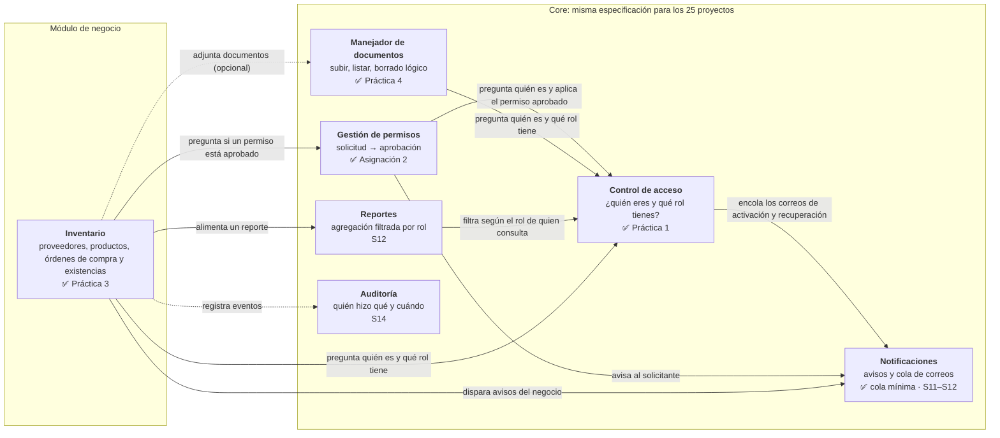
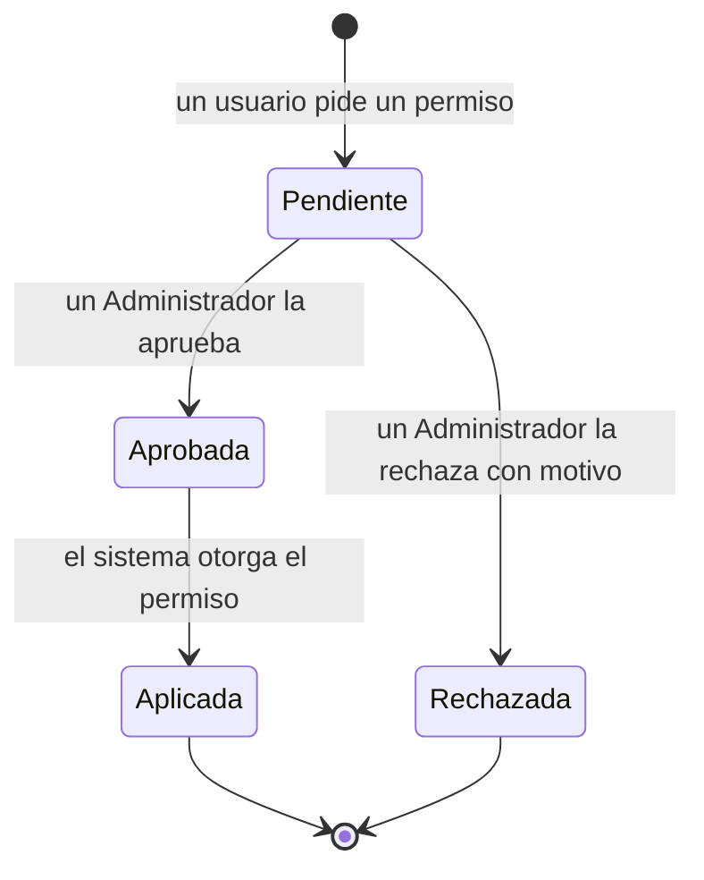

# Sistema de Inventario para Negocio Pequeño

Proyecto Final — **Programación III**
Instituto Tecnológico de las Américas (ITLA) — Cuatrimestre **2026-C-3**

| Campo | Valor |
|---|---|
| Estudiante | Yojairo Rodriguez |
| Asignatura | Programación III |
| Período | 2026-C-3 |
| Repositorio | https://github.com/yojairoivan-sketch/Proyecto-Final-P3 |
| Proyecto del catálogo | **#6 — Inventario para negocio pequeño** |

Aplicación web para que un negocio pequeño lleve el control de su inventario: **órdenes de compra** a proveedores, **movimientos de stock** y **alertas de stock bajo**. Como todos los proyectos del curso, tiene dos partes: el **Core** (la misma especificación para los 25 proyectos) y el **módulo de negocio** (inventario).

## Estado: Práctica 4 — El proyecto en un contenedor, con documentos y una API externa

Entregado en la etiqueta `practica-4`:

- **El Manejador de documentos** (pieza 3 del Core, RF-DOC-01 a 05): subir un archivo registrando nombre, tipo, tamaño, fecha y quién lo subió; listar solo los propios (un Administrador ve los de todos) y nunca los eliminados; descargar y eliminar solo su dueño o un Administrador, verificado en el servidor (RD-06); eliminar es lógico. Un archivo ausente, vacío o de más de 10 MB se rechaza con un mensaje (RD-07). Tiene pantalla, `/documentos`. Ver [cómo provocar cada criterio](#10-manejador-de-documentos-rf-doc-01-a-05).
- **Todo el proyecto con un solo comando** desde un clon limpio: `cp .env.example .env` y `docker compose up --build`. Hay un `Dockerfile` y un `.dockerignore` en la raíz, y solo la aplicación publica un puerto (http://localhost:8080). Ver [Contenedor](#contenedor).
- **Los datos sobreviven a `docker compose down`:** los archivos de los documentos viven en el volumen con nombre `documentos`, y la base (usuarios, solicitudes, inventario y registros de documentos) en `datos-postgres`. Ver la [sección 7](#7-reinicio-y-persistencia-rd-09-y-rf-doc-05).
- **Una API externa con su clave como secreto:** cotizar una orden de compra en otra moneda usa la tasa de cambio de ExchangeRate-API. La clave llega por la variable `TASA_CAMBIO_API_CLAVE` desde `.env`, que no se versiona. Sin clave, o con la API caída, la cotización se rechaza con un mensaje y lo demás sigue funcionando. Ver [API externa](#api-externa).
- **Pruebas nuevas:** la suite del Manejador de documentos (35) y las de la cotización y el cliente de la API (27). Todas siguen corriendo con [un solo comando](#pruebas). Control de acceso, Gestión de permisos y el negocio siguen como antes (secciones 1 a 5, 8 y 9).
- Entró por el pull request [#18](https://github.com/yojairoivan-sketch/Proyecto-Final-P3/pull/18).

Antes, en la etiqueta `practica-3`: el **módulo de negocio** (RF-NEG-02 a 06 y 09), con siete funcionalidades y la máquina de estados de la orden de compra en un solo punto; una operación que depende de Gestión de permisos (ajustar la existencia); la suite de la máquina de estados; una prueba de integración, y **cuatro defectos plantados** en `practica-3-defecto-1` a `practica-3-defecto-4` ([detalle](#práctica-3-máquina-de-la-orden-de-compra-e-integración)). Entró por el pull request [#17](https://github.com/yojairoivan-sketch/Proyecto-Final-P3/pull/17).

Antes, en la etiqueta `practica-2`: la **suite de Gestión de permisos ampliada** a 63 pruebas, con cada requisito de RF-GP-01 a RF-GP-07 nombrado en sus pruebas, y **seis defectos plantados (variante A)** en las etiquetas `practica-2-defecto-1` a `practica-2-defecto-6` ([detalle](#práctica-2-gestión-de-permisos-variante-a)). Entró por el pull request [#16](https://github.com/yojairoivan-sketch/Proyecto-Final-P3/pull/16).

Antes, en la etiqueta `asignacion-2`: **Gestión de permisos** (pieza 2 del Core). Un usuario pide permiso para una operación que su rol no le da; un Administrador lo aprueba o lo rechaza con un motivo, y al aprobarlo el sistema se lo otorga en el acto. Cubre RF-GP-01 a RF-GP-07, con la máquina de estados en un solo punto del código (RD-04) ([cómo provocar cada criterio](#9-gestión-de-permisos-rf-gp-01-a-07)), y trajo la primera suite de la pieza (45 pruebas) y la [bitácora con el agente](docs/bitacora-asignacion-2.md). Entró por los pull requests [#13](https://github.com/yojairoivan-sketch/Proyecto-Final-P3/pull/13) y [#14](https://github.com/yojairoivan-sketch/Proyecto-Final-P3/pull/14).

Antes, en la etiqueta `practica-1`: **Control de acceso completo** (RF-CA-01 a RF-CA-22), la **cola mínima de correos** (RF-NOT-08, 09, 12 y 13) y la **estructura de la máquina de estados del negocio** ([`docs/maquina-de-estados.md`](docs/maquina-de-estados.md)). Cada funcionalidad entró por su pull request: [#4 base](https://github.com/yojairoivan-sketch/Proyecto-Final-P3/pull/4), [#5 cola de correos](https://github.com/yojairoivan-sketch/Proyecto-Final-P3/pull/5), [#6 registro y activación](https://github.com/yojairoivan-sketch/Proyecto-Final-P3/pull/6), [#7 sesión](https://github.com/yojairoivan-sketch/Proyecto-Final-P3/pull/7), [#8 roles y administración](https://github.com/yojairoivan-sketch/Proyecto-Final-P3/pull/8), [#9 contraseñas](https://github.com/yojairoivan-sketch/Proyecto-Final-P3/pull/9), [#10 máquina de estados](https://github.com/yojairoivan-sketch/Proyecto-Final-P3/pull/10), [#11 README](https://github.com/yojairoivan-sketch/Proyecto-Final-P3/pull/11) y, después de la etiqueta, [#12 pruebas de Control de acceso](https://github.com/yojairoivan-sketch/Proyecto-Final-P3/pull/12).

## Diagrama de componentes

Las seis piezas del Core y el módulo de negocio viven dentro de la API (los contenedores están en [Contenedor](#contenedor)). Cada flecha va de la pieza que **requiere** a la que **provee**, y la etiqueta dice para qué. El Core nunca apunta al módulo de negocio (RD-03).



Casi todas las piezas registran sus acciones en Auditoría; esa flecha punteada se dibuja una sola vez para no llenar el diagrama. Las piezas marcadas con ✅ ya están construidas; las demás indican la semana en que llegan.

| Pieza | Proyecto | Interfaz que ofrece a las demás |
|---|---|---|
| Control de acceso | `backend/src/Inventario.Core.ControlAcceso` | `IUsuarioActual` («¿quién es y qué rol?»), `IOtorgamientoPermisos` («desde ahora este usuario puede ejecutar esta operación»), `IServicioCuentas`, `IServicioSesiones`, `IServicioContrasenas`, `IServicioUsuarios` |
| Gestión de permisos | `backend/src/Inventario.Core.GestionPermisos` | `IServicioSolicitudes` (pedir, consultar, aprobar y rechazar), `IPermisosConcedidos` («¿este usuario tiene aprobado este permiso?») y la máquina de estados `TransicionesSolicitud` |
| Notificaciones (cola de correos) | `backend/src/Inventario.Core.ColaCorreos` | `IColaCorreos.EncolarAsync` y `ProcesadorCola` |
| Manejador de documentos | `backend/src/Inventario.Core.Documentos` | `IServicioDocumentos` (subir, listar, consultar, descargar y eliminar) e `IAlmacenArchivos` (dónde vive el contenido de cada archivo) |
| Módulo de negocio | `backend/src/Inventario.Negocio` | `IServicioProveedores`, `IServicioProductos`, `IServicioOrdenes`, `IServicioExistencias`, `IServicioCotizaciones` y la máquina de estados `TransicionesOrdenCompra`. Requiere `ITasasDeCambio`, que implementa el cliente de la API externa |
| Host de la API | `backend/src/Inventario.Api` | Endpoints HTTP delgados y la tabla de roles por operación (`Acceso/Operaciones.cs`) |
| Enviador | `backend/src/Inventario.Enviador` | Proceso aparte que entrega la cola por SMTP |

Cada pieza tiene su propio esquema en PostgreSQL (`control_acceso`, `gestion_permisos`, `cola_correos`, `documentos` e `inventario`). Ninguna lee las tablas de otra: todo pasa por interfaces. Por ejemplo, Gestión de permisos pregunta quién es el usuario con `IUsuarioActual` y otorga el permiso aprobado con `IOtorgamientoPermisos`; nunca toca las tablas de Control de acceso. Del mismo modo, el negocio le pregunta a Gestión de permisos con `IPermisosConcedidos` si un usuario tiene aprobado un permiso, sin conocer los estados de una solicitud. Ningún proyecto `Inventario.Core.*` referencia a `Inventario.Negocio`.

## Requisitos

- **Docker Desktop** con Docker Compose v2 (`docker compose version`), ya iniciado.
- **Git**. Los comandos de abajo funcionan en Git Bash y en PowerShell, salvo los de `curl`, que están escritos para **Git Bash** (en Windows PowerShell 5.1, `curl` es otro comando).
- El puerto **8080** libre. Es el único que publica el proyecto: PostgreSQL, la API y Mailpit solo se ven dentro de la composición, así que no chocan con otros que tengas instalados. Si el 8080 está ocupado, cambia `WEB_PUERTO` y `URL_PUBLICA` en `.env`.

No hace falta instalar .NET, Node ni PostgreSQL: todo se compila y corre dentro de Docker.

## Contenedor

El proyecto completo corre en contenedores y arranca con **un solo comando**. Desde un clon limpio:

```bash
git clone https://github.com/yojairoivan-sketch/Proyecto-Final-P3.git
cd Proyecto-Final-P3
git checkout practica-4
cp .env.example .env
docker compose up --build
```

Copiar `.env.example` a `.env` es el único paso previo: trae un valor de ejemplo para cada variable (en PowerShell, `Copy-Item .env.example .env`). La primera vez tarda unos minutos, porque descarga las imágenes y compila. Está listo cuando el registro de `api` dice `Now listening on: http://[::]:8080`. Si quieres recuperar la terminal, agrega `-d`: `docker compose up --build -d`.

| Qué | Dirección |
|---|---|
| **La aplicación** (React) | **http://localhost:8080** |
| La API | http://localhost:8080/api (por ejemplo, http://localhost:8080/api/salud) |
| La bandeja del correo de pruebas (Mailpit) | http://localhost:8080/correo/ |

La portada dice «API: conectada». El primer Administrador se crea al arrancar con los datos de `.env`; con los de ejemplo, entra con **`admin@inventario.local`** y **`Admin12345`**.

**Para detenerlo:** `Ctrl+C` en la terminal de `up` (o `docker compose stop`), y luego `docker compose down`. `down` borra los contenedores, pero no los volúmenes: los datos y los documentos vuelven en el siguiente `docker compose up`. Solo `docker compose down -v` borra los volúmenes.

**La receta.** [`Dockerfile`](Dockerfile), en la raíz, construye la imagen de la aplicación en etapas: `api`, `web`, `enviador` y `pruebas`, y cada servicio elige la suya con `target`. [`.dockerignore`](.dockerignore) deja fuera el historial de git, `.env`, `node_modules`, `bin`, `obj` y `dist`.

**La composición** ([`docker-compose.yml`](docker-compose.yml)). Los servicios se encuentran por su nombre (`db`, `api`, `mailpit`), nunca por `localhost`. No hay pasos a mano: la API crea o actualiza sus tablas al arrancar.

| Servicio | Qué hace | Puerto publicado |
|---|---|---|
| `web` | nginx con la aplicación React. Reenvía `/api/` a `api` y `/correo/` a `mailpit`. | `8080` (o `WEB_PUERTO`) |
| `api` | La API (.NET 10), con las piezas del Core y el negocio. Al arrancar crea las tablas y el primer Administrador. | ninguno |
| `db` | PostgreSQL 17. | ninguno |
| `enviador` | Proceso aparte que entrega la cola de correos cada 5 segundos (RF-NOT-09). | ninguno |
| `mailpit` | Servidor SMTP de pruebas: recibe los correos y no envía nada afuera. | ninguno |

| Volumen | Qué guarda |
|---|---|
| `datos-postgres` | La base de datos: usuarios, sesiones, solicitudes, inventario y los registros de los documentos (RD-09). |
| `documentos` | El contenido de los documentos subidos, montado en `/datos/documentos` del servicio `api` (RF-DOC-05). Nunca queda dentro de la imagen. |

Los registros se ven con `docker compose logs api` (o `web`, `enviador`). Para leer la base: `docker compose exec db psql -U inventario -d inventario`.

### Variables de entorno

Todas van en `.env`, que nunca se sube al repositorio (`.gitignore` lo excluye). [`.env.example`](.env.example) las trae todas, cada una con un valor de ejemplo con el que el proyecto arranca. Para un uso real, cambia las contraseñas y pon tu clave de la API.

| Variable | Para qué | Valor de ejemplo |
|---|---|---|
| `POSTGRES_DB` | Nombre de la base de datos. | `inventario` |
| `POSTGRES_USER` | Usuario de la base de datos. | `inventario` |
| `POSTGRES_PASSWORD` | Contraseña de ese usuario. | `clave-de-ejemplo-123` |
| `URL_PUBLICA` | Dirección con la que se abre la aplicación; con ella se arman los enlaces de los correos. | `http://localhost:8080` |
| `WEB_PUERTO` | Puerto de tu equipo en el que responde la aplicación. Si lo cambias, cambia también `URL_PUBLICA`. | `8080` |
| `ADMIN_NOMBRE` | Nombre del primer Administrador, que se crea al arrancar si no existe. | `Administrador` |
| `ADMIN_CORREO` | Correo con el que entra ese Administrador. | `admin@inventario.local` |
| `ADMIN_CONTRASENA` | Su contraseña (8 a 128 caracteres, con letras y números). | `Admin12345` |
| `SMTP_HOST` | Servidor de correo saliente. | `mailpit` |
| `SMTP_PUERTO` | Puerto de ese servidor. | `1025` |
| `SMTP_SEGURIDAD` | `Ninguna`, `StartTls` o `SslAlConectar`. | `Ninguna` |
| `SMTP_USUARIO` | Usuario del servidor de correo. Mailpit acepta cualquiera. | `inventario` |
| `SMTP_CONTRASENA` | Su contraseña (en Gmail, una contraseña de aplicación). | `clave-de-ejemplo` |
| `SMTP_REMITENTE` | Dirección que aparece como remitente. | `inventario@inventario.local` |
| `TASA_CAMBIO_API_CLAVE` | Clave de ExchangeRate-API (ver [API externa](#api-externa)). Con el valor de ejemplo, la cotización se rechaza con un mensaje y lo demás funciona. | `clave-de-ejemplo` |

Si falta una variable obligatoria, `docker compose` se detiene y dice cuál. Solo el enviador recibe las variables `SMTP_*`, así que una operación de la API nunca habla con el servidor de correo; y solo la API recibe `TASA_CAMBIO_API_CLAVE`.

### Correo real (Gmail)

Para que los correos lleguen a una bandeja real (por ejemplo, al registrarte con tu propio correo), usa una cuenta de Gmail con verificación en dos pasos:

1. En https://myaccount.google.com/apppasswords crea una contraseña de aplicación (16 letras).
2. En `.env` pon:
   - `SMTP_HOST=smtp.gmail.com`
   - `SMTP_PUERTO=587`
   - `SMTP_SEGURIDAD=StartTls`
   - `SMTP_USUARIO` y `SMTP_REMITENTE`: tu dirección de Gmail.
   - `SMTP_CONTRASENA`: la contraseña de aplicación, sin espacios.
3. Aplica el cambio con `docker compose up -d`, que vuelve a crear el enviador con las variables nuevas. Desde ahí, cada correo llega a la bandeja del destinatario en unos segundos y su enlace abre `URL_PUBLICA`.

## API externa

| | |
|---|---|
| **Qué API es** | [ExchangeRate-API](https://www.exchangerate-api.com), tasas de cambio entre monedas. Exige una clave; el plan gratis la da al registrarse. |
| **Qué operación la usa** | **Cotizar una orden de compra en otra moneda** (funcionalidad 8 del negocio): `GET /api/ordenes/{id}/cotizacion?moneda=USD`. Los costos del inventario se registran en pesos dominicanos (DOP). La operación toma el total de la orden, le pide a la API la tasa DOP → moneda y devuelve el total convertido, redondeado a 2 decimales. Sirve, por ejemplo, para pagarle en dólares a un proveedor del exterior. |
| **Variable** | `TASA_CAMBIO_API_CLAVE`, en `.env`. Compose se la pasa solo a `api`, y el código la lee de la variable de entorno (RD-10). |
| **Código** | [`TasasExchangeRateApi.cs`](backend/src/Inventario.Negocio/Cotizaciones/TasasExchangeRateApi.cs) (el cliente de la API) y [`ServicioCotizaciones.cs`](backend/src/Inventario.Negocio/Cotizaciones/ServicioCotizaciones.cs) (la operación). |

La clave no está en el código, ni en el `Dockerfile`, ni en `docker-compose.yml`, ni en la imagen, ni en ningún commit: solo en tu `.env`, que `.gitignore` excluye. La API la recibe en la ruta de la URL, así que esa URL nunca se escribe en el registro.

**Para usar tu clave:** regístrate gratis en https://www.exchangerate-api.com, confirma tu correo, copia la clave que te dan y ponla en `.env` (`TASA_CAMBIO_API_CLAVE=tu-clave`). Después corre `docker compose up -d`, que vuelve a crear `api` con la variable nueva.

**Un ejemplo real.** Esta es la orden de la [sección 8](#funcionalidad-3-armar-una-orden-de-compra) (10 sacos de arroz a 850 DOP y 24 botellas de aceite a 210.50 DOP), cotizada en dólares:

```bash
curl -s "$API/ordenes/$ORDEN/cotizacion?moneda=USD" -H "$E"
```

Respuesta obtenida el 9 de noviembre de 2026, hora de República Dominicana (formateada para leerla):

```json
{
  "mensaje": "La orden 3 suma 13,552.00 DOP, unos 222.79 USD con la tasa de ExchangeRate-API.",
  "cotizacion": {
    "ordenId": 3,
    "proveedor": "Molinos del Norte",
    "estado": "Borrador",
    "monedaOrden": "DOP",
    "total": 13552,
    "moneda": "USD",
    "tasa": 0.01644,
    "totalConvertido": 222.79,
    "tasaActualizadaEn": "2026-11-10T00:00:01+00:00",
    "fuente": "ExchangeRate-API"
  }
}
```

Para esa cotización, ExchangeRate-API respondió esto a `GET https://v6.exchangerate-api.com/v6/<clave>/pair/DOP/USD` (sin la clave):

```json
{
  "result": "success",
  "documentation": "https://www.exchangerate-api.com/docs",
  "terms_of_use": "https://www.exchangerate-api.com/terms",
  "time_last_update_unix": 1794268801,
  "time_last_update_utc": "Tue, 10 Nov 2026 00:00:01 +0000",
  "time_next_update_unix": 1794355201,
  "time_next_update_utc": "Wed, 11 Nov 2026 00:00:01 +0000",
  "base_code": "DOP",
  "target_code": "USD",
  "conversion_rate": 0.01644
}
```

La cuenta: 13 552 DOP × 0.01644 = 222.79 USD, redondeado a 2 decimales.

**Sin clave o con la API caída (RD-07, RD-08).** La cotización responde **503** con un mensaje que se entiende, y el resto del proyecto sigue funcionando:

| Situación | Respuesta |
|---|---|
| La clave de ejemplo de `.env.example` | 503: «El servicio de tasas de cambio no aceptó la clave de TASA_CAMBIO_API_CLAVE (respondió «invalid-key»). Pon en .env tu clave de exchangerate-api.com, con la cuenta ya confirmada.» Para una clave inventada, la API a veces responde `inactive-account` en vez de `invalid-key`; el mensaje es el mismo. |
| `TASA_CAMBIO_API_CLAVE` vacía o sin definir | 503: «La cotización en otra moneda no está disponible: falta la clave de la API de tasas de cambio (variable TASA_CAMBIO_API_CLAVE en .env).» No se llama a la API. |
| La API no responde (sin red, caída o más de 10 s) | 503: «El servicio de tasas de cambio no respondió. Intenta de nuevo en unos minutos.» |
| Se agotaron las consultas del mes | 503: «Se agotaron las consultas del mes en el servicio de tasas de cambio…» |

Lo que pasa cuando la API no responde se comprueba en las pruebas, sin internet: `SiLaApiNoRespondeSeRechazaSinExcepcion` y `SiLaApiTardaDemasiadoSeRechazaSinExcepcion` ([Pruebas](#pruebas)). Para verlo en la aplicación, apaga la red del equipo y repite la cotización. Las filas para provocar cada caso están en la [funcionalidad 8](#funcionalidad-8-cotizar-una-orden-en-otra-moneda-api-externa).

## Cómo provocar cada criterio de aceptación

Control de acceso y Gestión de permisos se pueden probar desde la interfaz (http://localhost:8080) o armando la petición a mano con `curl`; el módulo de negocio, con `curl`. Los `curl` de abajo son para **Git Bash**. En los textos que mandes con `curl` (por ejemplo un motivo de rechazo), no uses tildes: en Windows, `curl.exe` manda los argumentos en otra codificación y la API responde «La petición no tiene el formato esperado». Desde la interfaz las tildes funcionan bien.

Control de acceso (Práctica 1) está en las secciones 1 a 5, el módulo de negocio (Práctica 3) en la [sección 8](#8-módulo-de-negocio-inventario-rf-neg-02-a-06-y-09), Gestión de permisos en la [sección 9](#9-gestión-de-permisos-rf-gp-01-a-07) y el Manejador de documentos (Práctica 4) en la [sección 10](#10-manejador-de-documentos-rf-doc-01-a-05). Para los `curl`, usa los datos del Administrador de `.env` (con los de ejemplo, `admin@inventario.local` y `Admin12345`). Las suites y los defectos no necesitan la aplicación levantada: están en [Pruebas](#pruebas) y [Defectos](#defectos).

**Preparación.** Para leer la base de datos:

```bash
docker compose exec db psql -U inventario -d inventario
```

(Si cambiaste `POSTGRES_USER` o `POSTGRES_DB`, usa tus valores.) Dentro de `psql`, `\q` sale.

Para guardar la credencial de sesión de un usuario en la variable `TOKEN` (cambia correo y contraseña):

```bash
TOKEN=$(curl -s http://localhost:8080/api/acceso/sesion -H 'Content-Type: application/json' -d '{"correo":"tu@correo.com","contrasena":"TuClave123"}' | sed -nE 's/.*"token":"([^"]+)".*/\1/p'); echo $TOKEN
```

### 1. Registro y activación (RF-CA-01, 02, 04, 14, 15, 16 y 17)

| Para comprobar | Haz esto | Resultado esperado |
|---|---|---|
| Registro | En `/registro` crea una cuenta con tu correo y una contraseña válida (por ejemplo `clave1234`). | «Cuenta creada. Te enviamos un correo con el enlace para activarla.» |
| Login antes de activar | En `/iniciar-sesion` entra con esa cuenta. | «La cuenta no está activa. Ábrela con el enlace que te enviamos por correo.» (403) |
| El correo sale por la cola | Espera unos segundos (el enviador revisa la cola cada 5) y abre http://localhost:8080/correo/ (o tu bandeja, si configuraste Gmail). | Llega «Activa tu cuenta de Inventario» con el enlace. |
| Abrir el enlace | Ábrelo. | «Cuenta activada. Ya puedes iniciar sesión.» |
| Abrirlo por segunda vez | Vuelve a abrir el mismo enlace. | «Este enlace de activación ya se usó…» (400). La cuenta no cambia. |
| Correo duplicado | Regístrate otra vez con el mismo correo. | «Ya existe una cuenta con ese correo.» (409) |
| Contraseña de 5 caracteres | Regístrate con la contraseña `ab123`. | «La contraseña debe tener al menos 8 caracteres.» (400) |
| Correo mal formado | Regístrate con el correo `ana@@ejemplo`. | «El correo no tiene un formato válido.» (400) |
| Datos vacíos o JSON roto | `curl -i http://localhost:8080/api/acceso/registro -H 'Content-Type: application/json' -d '{"nombre":'` | 400 con un mensaje en español, sin trazas. |
| Reenvío del enlace | En `/reenviar-activacion` pide el enlace con un correo inexistente y con uno pendiente de activar. | La misma respuesta en los dos casos. El enlace anterior deja de servir: «Este enlace ya no sirve porque se pidió uno nuevo…». |
| Enlace vencido | Pide un enlace nuevo, corre en `psql` `update control_acceso.tokens_activacion set vence_en = now() - interval '1 minute' where not usado;` y abre el enlace. | «Este enlace de activación venció. Pide uno nuevo.» (400) |
| Rol único | En `psql`: `select correo, rol_id from control_acceso.usuarios;` | Cada usuario tiene un `rol_id` (1 = Administrador, 2 = Estándar); la columna no admite nulos. Todo usuario nuevo nace Estándar. |

### 2. Almacenamiento de las contraseñas (RF-CA-02, RD-05)

Registra y activa dos usuarios con la **misma** contraseña y, en `psql`:

```sql
select correo, hash_contrasena from control_acceso.usuarios;
```

La contraseña no aparece en ninguna columna, y los dos hashes son distintos. Es PBKDF2 con sal aleatoria (`PasswordHasher` de ASP.NET Core Identity), así que no se puede revertir.

### 3. Sesión (RF-CA-03, 07, 18 y 19)

| Para comprobar | Haz esto | Resultado esperado |
|---|---|---|
| Rechazos idénticos | Inicia sesión con tu correo y una contraseña incorrecta, y luego con un correo que no existe. | Los dos dan «Correo o contraseña incorrectos.» (401), sin decir cuál dato falló. |
| Sesión correcta | Entra con los datos correctos. | Lleva a `/cuenta` con tu nombre, correo y rol (`GET /api/yo`). |
| Consulta sin sesión | `curl -i http://localhost:8080/api/yo` | 401: «Necesitas iniciar sesión para usar esta operación.» |
| Cerrar sesión | Guarda tu `TOKEN` y ciérrala: `curl -i -X DELETE http://localhost:8080/api/acceso/sesion -H "Authorization: Bearer $TOKEN"` | «Sesión cerrada.» |
| Credencial cerrada | `curl -i http://localhost:8080/api/yo -H "Authorization: Bearer $TOKEN"` | 401: «La sesión no es válida o ya terminó…» |
| Bloqueo | Falla la contraseña cinco veces seguidas y luego usa la correcta. | El sexto intento da «La cuenta está bloqueada por 5 intentos fallidos seguidos. Intenta de nuevo en 15 minutos.» (423), aunque la contraseña sea correcta. |
| Fin del bloqueo y contador | Espera 15 minutos o, en `psql`, `update control_acceso.usuarios set bloqueado_hasta = now() where correo = 'tu@correo.com';`. Entra con la contraseña correcta. | Entra, y `select intentos_fallidos from control_acceso.usuarios where correo = 'tu@correo.com';` da 0. |

### 4. Roles y administración (RF-CA-04, 05, 06, 08, 20 y 21, RD-06)

**Exigencia de rol en un solo punto (RF-CA-05):** [`backend/src/Inventario.Api/Acceso/Operaciones.cs`](backend/src/Inventario.Api/Acceso/Operaciones.cs). Cada operación del sistema está ahí, en una línea, con los roles que la pueden ejecutar. Cada endpoint la declara con `.Requiere(Operaciones.X)`; si un endpoint no la declara, la API no arranca. El servidor verifica sesión y rol en cada petición, antes de leer el cuerpo.

| Operación | Quién |
|---|---|
| ConsultarSalud, Registrarse, ActivarCuenta, ReenviarActivacion, IniciarSesion, SolicitarRecuperacion, RestablecerContrasena | Pública |
| ConsultarMiCuenta, CerrarSesion, CambiarMiContrasena, ConsultarPermisosSolicitables, CrearSolicitudPermiso, ConsultarMisSolicitudes, ConsultarSolicitud | Administrador o Estándar |
| CambiarRol, DesactivarUsuario, ForzarRestablecimiento, ConsultarSolicitudesPendientes, AprobarSolicitud, RechazarSolicitud | Administrador |
| ListarUsuarios, ReactivarUsuario | Administrador, o quien recibió ese permiso con una solicitud aprobada ([sección 9](#9-gestión-de-permisos-rf-gp-01-a-07)) |
| Documentos: SubirDocumento, ConsultarDocumentos, DescargarDocumento, EliminarDocumento | Administrador o Estándar; luego la pieza deja ver, descargar y eliminar cada documento solo a su dueño o a un Administrador ([sección 10](#10-manejador-de-documentos-rf-doc-01-a-05)) |
| Negocio: ConsultarProveedores, ConsultarProductos, ConsultarStockBajo, ConsultarMovimientos, RegistrarSalida, ConsultarOrdenesCompra, CrearOrdenCompra, AgregarLineaOrden, CotizarOrden | Administrador o Estándar |
| Negocio: RegistrarProveedor, RegistrarProducto | Administrador |
| Negocio: CambiarEstadoOrden | Administrador o Estándar; luego la máquina de estados dice qué rol hace cada transición ([`TransicionesOrdenCompra.cs`](backend/src/Inventario.Negocio/Ordenes/TransicionesOrdenCompra.cs)) |
| Negocio: AjustarExistencia | Administrador o Estándar; luego el negocio exige ser Administrador o tener el permiso aprobado en Gestión de permisos ([`ServicioExistencias.cs`](backend/src/Inventario.Negocio/Existencias/ServicioExistencias.cs)) |

Las dos últimas filas no repiten la regla en dos lugares: `Operaciones.cs` exige la sesión, y la regla fina vive una sola vez, en la tabla de transiciones o en el servicio que consulta a Gestión de permisos.

| Para comprobar | Haz esto | Resultado esperado |
|---|---|---|
| Estándar invoca una operación de Administrador a mano | Con el `TOKEN` de un usuario Estándar: `curl -i http://localhost:8080/api/usuarios -H "Authorization: Bearer $TOKEN"` | 403: «La operación ListarUsuarios es solo para: Administrador. Tu rol es Estándar.» |
| Estándar intenta cambiar su propio rol | Con su `TOKEN` y su id (sale en `GET /api/yo`): `curl -i -X PUT http://localhost:8080/api/usuarios/<id>/rol -H "Authorization: Bearer $TOKEN" -H 'Content-Type: application/json' -d '{"rol":"Administrador"}'` | 403. El rol no cambia. |
| Listar usuarios | Entra con el Administrador de `.env` y abre `/usuarios`. | Nombre, correo, rol y estado (Activo, Pendiente de activación o Desactivado). La respuesta de `GET /api/usuarios` no trae hashes ni tokens. |
| Cambiar un rol | En `/usuarios`, cambia el rol de otro usuario con el selector. | «Rol cambiado a …». Con `curl`, el cuerpo es `{"rol":"Administrador"}` o `{"rol":"Estandar"}` (se acepta con o sin tilde). |
| Desactivar a un usuario con sesión abierta | Entra con ese usuario en otro navegador (o guarda su `TOKEN`). Como Administrador, pulsa «Desactivar». Luego usa su sesión: `curl -i http://localhost:8080/api/yo -H "Authorization: Bearer $TOKEN"` | Su sesión da 401, y si intenta entrar: «La cuenta está desactivada. Habla con un administrador.» (403). «Reactivar» le devuelve el acceso. |
| Desactivarse a sí mismo | En `/usuarios`, pulsa «Desactivar» en tu propia fila. | «Un Administrador no puede desactivarse a sí mismo.» (409) |
| Último Administrador | Intenta pasarte a Estándar cuando eres el único Administrador activo. | «No se puede quitar el rol al último Administrador activo.» (409) |

### 5. Contraseñas: recuperación, cambio y restablecimiento (RF-CA-09 a 13 y 22)

| Para comprobar | Haz esto | Resultado esperado |
|---|---|---|
| Respuesta idéntica | En `/recuperar` pide el código con un correo inexistente y con uno registrado. | Los dos: «Si el correo corresponde a una cuenta activa, te enviamos un código…». |
| Código por la cola | Espera unos segundos y abre en http://localhost:8080/correo/ el correo «Código para restablecer tu contraseña…». | Trae el código y el enlace `/restablecer?codigo=...`, que vence en 30 minutos. |
| Usar el código | Abre el enlace y define una contraseña nueva. | «Contraseña cambiada…». |
| Usarlo otra vez | Vuelve a enviar el mismo código. | «Este código de recuperación ya se usó…» (400). La contraseña no cambia. |
| Contraseña vieja y nueva | Inicia sesión con la vieja y luego con la nueva. | La vieja da 401; la nueva entra. |
| Credencial emitida antes | Guarda un `TOKEN` antes de restablecer y úsalo después: `curl -i http://localhost:8080/api/yo -H "Authorization: Bearer $TOKEN"` | 401. |
| Código vencido | Pide otro código, corre en `psql` `update control_acceso.codigos_recuperacion set vence_en = now() - interval '1 minute' where not usado;` y úsalo. | «El código de recuperación venció. Pide uno nuevo.» (400). La contraseña no cambia. |
| Restablecimiento forzado | Como Administrador, en `/usuarios` pulsa «Forzar restablecimiento» en otro usuario. | Su contraseña anterior y sus sesiones dejan de servir en ese momento. En unos segundos le llega «Un administrador restableció tu contraseña…» con el código. |
| Cambio con la actual incorrecta | En `/cuenta`, cambia la contraseña escribiendo mal la actual. | «La contraseña actual no es correcta. La contraseña no cambió.» (400) |
| Cambio correcto | Cambia la contraseña con la actual correcta. | Todas las sesiones se cierran (también la actual) y hay que entrar con la nueva. La nueva también debe cumplir la política. |

### 6. Correo por cola (RF-NOT-08, 09, 12 y 13)

El enviador es un proceso aparte (el servicio `enviador`) que revisa la cola cada 5 segundos. La API nunca habla con el servidor SMTP: solo deja el correo en la cola.

1. Apaga el servidor de correo de pruebas: `docker compose stop mailpit`.
2. Registra un usuario nuevo en `/registro`. La operación termina bien.
3. En `psql`: `select id, destinatario, estado, intentos, ultimo_error from cola_correos.correos_en_cola order by id;`. El correo está **Pendiente**; con cada pasada del enviador `intentos` sube y `ultimo_error` dice por qué no salió (por ejemplo, `SocketException: Name or service not known`). `docker compose logs enviador` muestra «Con error (siguen pendientes): 1».
4. Enciende el servidor: `docker compose start mailpit`. En unos segundos el enviador lo entrega («Enviados: 1» en `docker compose logs enviador`) y en la tabla queda **Enviado**. En http://localhost:8080/correo/ aparece una sola vez: las pasadas siguientes no lo vuelven a mandar.

Para ver que la cola guarda el correo aunque no haya enviador: `docker compose stop enviador`, registra a alguien (queda Pendiente con `intentos = 0`) y `docker compose start enviador`. Si usas Gmail en vez de Mailpit, esta es la forma de probarlo.

Las credenciales SMTP solo están en `.env` (fuera del repositorio) y se leen como variables de entorno.

### 7. Reinicio y persistencia (RD-09 y RF-DOC-05)

Los datos viven en dos volúmenes con nombre, fuera de la imagen y de los contenedores: `datos-postgres` (la base) y `documentos` (los archivos subidos).

1. Sube un documento en `/documentos` (o como en la [sección 10](#10-manejador-de-documentos-rf-doc-01-a-05)).
2. `docker compose down` (sin `-v`): borra los contenedores.
3. `docker compose up -d`: los vuelve a crear.
4. Inicia sesión con el mismo usuario: entra sin problema. En `/documentos` el documento sigue en el listado, y «Descargar» trae el mismo contenido. Con `curl`, repite el listado y la descarga de la sección 10.

`docker volume ls` muestra los dos volúmenes (`<carpeta>_datos-postgres` y `<carpeta>_documentos`). Para ver los archivos guardados: `docker compose exec -T api sh -c 'ls -l $DOCUMENTOS_CARPETA'`. Cada archivo tiene un nombre que genera la aplicación; el nombre original está en la tabla `documentos.documentos`.

`docker compose restart` también lo conserva todo.

### 8. Módulo de negocio: inventario (RF-NEG-02 a 06 y 09)

El negocio lleva el inventario de una tienda pequeña: a quién se le compra, qué productos hay y cuántos, las órdenes de compra y cada movimiento de la existencia. Son ocho funcionalidades separables: cada una tiene su servicio, sus endpoints y sus pruebas, y se puede probar sin las demás.

| # | Funcionalidad | Endpoints | Pruebas |
|---|---|---|---|
| 1 | Proveedores: registrar y listar | `POST/GET /api/proveedores` | `CatalogoPruebas` |
| 2 | Productos: registrar y listar con su existencia | `POST/GET /api/productos` | `CatalogoPruebas` |
| 3 | Armar una orden de compra: crearla, agregarle líneas, consultarla | `POST/GET /api/ordenes`, `GET /api/ordenes/{id}`, `POST /api/ordenes/{id}/lineas` | `OrdenesPruebas` |
| 4 | Ciclo de la orden (máquina de estados): enviar, recibir, cancelar | `POST /api/ordenes/{id}/estado` | `TransicionesOrdenCompraPruebas`, `OrdenesPruebas` |
| 5 | Salidas de mercancía e historial de movimientos | `POST /api/productos/{id}/salidas`, `GET /api/productos/{id}/movimientos` | `ExistenciasPruebas` |
| 6 | Ajuste por conteo físico, con permiso de Gestión de permisos | `POST /api/productos/{id}/ajuste` | `ExistenciasPruebas`, `AjusteConPermisoPruebas` (integración) |
| 7 | Alerta de stock bajo | `GET /api/productos/stock-bajo` | `CatalogoPruebas` |
| 8 | Cotizar una orden en otra moneda, con la [API externa](#api-externa) | `GET /api/ordenes/{id}/cotizacion?moneda=USD` | `CotizacionesPruebas`, `TasasExchangeRateApiPruebas` |

**Protegidas por Control de acceso (RF-NEG-06).** Todos los endpoints del negocio declaran su operación en [`Operaciones.cs`](backend/src/Inventario.Api/Acceso/Operaciones.cs) (tabla de la [sección 4](#4-roles-y-administración-rf-ca-04-05-06-08-20-y-21-rd-06)): sin sesión válida dan 401 y con un rol que no alcanza, 403. Los servicios del negocio vuelven a exigir la sesión, así que tampoco se ejecutan sin ella si alguien los llama sin pasar por la API.

**Máquina de estados (RF-NEG-03, 04, 05, RD-04).** Los estados están en [`EstadoOrdenCompra.cs`](backend/src/Inventario.Negocio/Ordenes/EstadoOrdenCompra.cs). Las transiciones permitidas, las prohibidas explícitas y los terminales se resuelven en un único punto, [`TransicionesOrdenCompra.cs`](backend/src/Inventario.Negocio/Ordenes/TransicionesOrdenCompra.cs). Las tablas, el diagrama y la prueba de cada fila están en [`docs/maquina-de-estados.md`](docs/maquina-de-estados.md). La máquina no comparte código con la de Gestión de permisos (RF-NEG-09).

**Datos (RD-09).** Todo vive en el esquema `inventario` de PostgreSQL: `proveedores`, `productos`, `ordenes_de_compra`, `lineas_orden_compra` y `movimientos_existencia`. La existencia de un producto solo cambia con un movimiento, y cada movimiento guarda cuánto, por qué, quién y cuándo.

**Preparación.** Esta etapa del negocio no tiene pantallas propias: se prueba con `curl` (pedir y aprobar el permiso de la funcionalidad 6 también se puede hacer en `/permisos`). Necesitas la sesión del Administrador de `.env` y la de un usuario Estándar (regístralo y actívalo como en la [sección 1](#1-registro-y-activación-rf-ca-01-02-04-14-15-16-y-17) si no tienes uno). En Git Bash, con tus correos y contraseñas:

```bash
token() { curl -s http://localhost:8080/api/acceso/sesion -H 'Content-Type: application/json' -d "{\"correo\":\"$1\",\"contrasena\":\"$2\"}" | sed -nE 's/.*"token":"([^"]+)".*/\1/p'; }
TOKEN_ADMIN=$(token admin@inventario.local Admin12345)
TOKEN_EST=$(token estandar@tu-correo.com clave1234)
API=http://localhost:8080/api; J='Content-Type: application/json'; A="Authorization: Bearer $TOKEN_ADMIN"; E="Authorization: Bearer $TOKEN_EST"
primer_id() { tee /dev/stderr | grep -o '"id":[0-9]*' | head -1 | cut -d: -f2; }
estado() { curl -s -w '  [HTTP %{http_code}]\n' $API/ordenes/$1/estado -H "Authorization: Bearer $2" -H "$J" -d "{\"hacia\":\"$3\"}"; }
echo "$TOKEN_ADMIN / $TOKEN_EST"
```

`primer_id` muestra la respuesta y guarda el primer `id` que trae; `estado <orden> <token> <estado>` pide un cambio de estado y muestra el código HTTP. Sigue las tablas en orden: cada fila usa lo que dejó la anterior. Para mirar la base: `docker compose exec db psql -U inventario -d inventario`.

#### Funcionalidad 1: proveedores

| Para comprobar | Haz esto | Resultado esperado |
|---|---|---|
| Registrar (Administrador) | `PROV=$(curl -s $API/proveedores -H "$A" -H "$J" -d '{"nombre":"Molinos del Norte","telefono":"809-555-0101","correo":"ventas@molinos.com"}' \| primer_id); echo; echo $PROV` | «Proveedor Molinos del Norte registrado.», con su `id` (queda en `PROV`). |
| Un Estándar no registra | `curl -i $API/proveedores -H "$E" -H "$J" -d '{"nombre":"Otro"}'` | 403: «La operación RegistrarProveedor es solo para: Administrador. Tu rol es Estándar.» |
| Sin sesión | `curl -i $API/proveedores` | 401: «Necesitas iniciar sesión para usar esta operación.» |
| Datos inválidos (RD-07) | `curl -i $API/proveedores -H "$A" -H "$J" -d '{"nombre":"","correo":"ventas@@molinos"}'` | 400: «Falta el nombre. El correo no tiene un formato válido.» No se guarda nada. |
| Listar (cualquier rol) | `curl -s $API/proveedores -H "$E"` | La lista, con Molinos del Norte. |

#### Funcionalidad 2: productos

| Para comprobar | Haz esto | Resultado esperado |
|---|---|---|
| Registrar (Administrador) | `ARROZ=$(curl -s $API/productos -H "$A" -H "$J" -d '{"nombre":"Arroz selecto","sku":"arr-1","unidadMedida":"saco","puntoReorden":5}' \| primer_id); echo; echo $ARROZ` | «Producto Arroz selecto registrado con existencia 0.», con `"sku":"ARR-1"` y `"existencia":0`. |
| Otro producto | `ACEITE=$(curl -s $API/productos -H "$A" -H "$J" -d '{"nombre":"Aceite de soya","sku":"ACE-1","unidadMedida":"botella","puntoReorden":12}' \| primer_id); echo; echo $ACEITE` | «Producto Aceite de soya registrado con existencia 0.» |
| SKU repetido | `curl -i $API/productos -H "$A" -H "$J" -d '{"nombre":"Arroz integral","sku":"ARR-1","unidadMedida":"saco","puntoReorden":5}'` | 409: «Ya existe un producto con el SKU ARR-1.» |
| Datos inválidos (RD-07) | `curl -i $API/productos -H "$A" -H "$J" -d '{"nombre":"Azucar","sku":"AZU 1","unidadMedida":"","puntoReorden":-1}'` | 400: «El SKU no puede tener espacios. Falta la unidad de medida. El punto de reorden no puede ser menor que cero.» |
| Un Estándar no registra | `curl -i $API/productos -H "$E" -H "$J" -d '{"nombre":"Sal","sku":"SAL-1","unidadMedida":"paquete","puntoReorden":3}'` | 403: «La operación RegistrarProducto es solo para: Administrador. Tu rol es Estándar.» |
| Listar (cualquier rol) | `curl -s $API/productos -H "$E"` | Los dos productos, con existencia 0. |

#### Funcionalidad 3: armar una orden de compra

| Para comprobar | Haz esto | Resultado esperado |
|---|---|---|
| Crear (cualquier rol) | `ORDEN=$(curl -s $API/ordenes -H "$E" -H "$J" -d "{\"proveedorId\":$PROV}" \| primer_id); echo; echo $ORDEN` | 201: «Orden de compra … creada en Borrador. Agrégale productos.», con `"estado":"Borrador"` y `"lineas":[]`. |
| Agregar líneas | `curl -s $API/ordenes/$ORDEN/lineas -H "$E" -H "$J" -d "{\"productoId\":$ARROZ,\"cantidad\":10,\"costoUnitario\":850}"` y luego `curl -s $API/ordenes/$ORDEN/lineas -H "$E" -H "$J" -d "{\"productoId\":$ACEITE,\"cantidad\":24,\"costoUnitario\":210.50}"` | «Se agregó Arroz selecto a la orden.» y «Se agregó Aceite de soya a la orden.». La segunda respuesta trae las dos líneas, con subtotales 8500 y 5052, y `"total":13552`. |
| El mismo producto otra vez | Repite la línea del arroz. | 409: «Arroz selecto ya está en la orden. Cada producto va en una sola línea.» |
| Datos inválidos (RD-07) | `curl -i $API/ordenes/$ORDEN/lineas -H "$E" -H "$J" -d "{\"productoId\":$ARROZ,\"cantidad\":0,\"costoUnitario\":-1}"` | 400: «La cantidad tiene que ser mayor que cero. El costo unitario no puede ser menor que cero.» |
| Proveedor que no existe | `curl -i $API/ordenes -H "$E" -H "$J" -d '{"proveedorId":9999}'` | 400: «No existe un proveedor con id 9999.» |
| Consultar y filtrar | `curl -s $API/ordenes/$ORDEN -H "$E"`, `curl -s "$API/ordenes?estado=Borrador" -H "$E"` y `curl -i "$API/ordenes?estado=Volar" -H "$E"` | La orden con sus líneas; las órdenes en Borrador; 400: «El estado «Volar» no existe. Los estados son: Borrador, Enviada, Recibida, Cancelada.» |

#### Funcionalidad 4: el ciclo de la orden (máquina de estados)

Cada fila dice qué fila de las tablas de [`docs/maquina-de-estados.md`](docs/maquina-de-estados.md) provoca. Todas usan `POST /api/ordenes/{id}/estado` con `{"hacia":"<estado>"}`, a través de la función `estado`.

| Para comprobar | Haz esto | Resultado esperado |
|---|---|---|
| Permitida 1, quién: un Estándar no envía | `estado $ORDEN $TOKEN_EST Enviada` | 403: «Pasar una orden de Borrador a Enviada es solo para: Administrador. Tu rol es Estándar. La orden sigue Borrador.» |
| Permitida 1, condición: sin líneas no se envía | `VACIA=$(curl -s $API/ordenes -H "$A" -H "$J" -d "{\"proveedorId\":$PROV}" \| primer_id); echo; estado $VACIA $TOKEN_ADMIN Enviada` | 409: «No se puede enviar una orden sin líneas: agrégale al menos un producto. La orden sigue Borrador.» |
| Prohibida 3: recibir sin enviar | `estado $ORDEN $TOKEN_EST Recibida` | 409: «No se recibe una orden que no se envió: primero hay que enviársela al proveedor. La orden sigue Borrador.» La existencia no cambia. |
| Prohibida 4: al mismo estado | `estado $ORDEN $TOKEN_ADMIN Borrador` | 409: «La orden ya está Borrador. La orden sigue Borrador.» |
| Permitida 1: el Administrador envía | `estado $ORDEN $TOKEN_ADMIN Enviada` | 200: «La orden pasó de Borrador a Enviada.» |
| Una enviada no admite líneas | `curl -i $API/ordenes/$ORDEN/lineas -H "$A" -H "$J" -d "{\"productoId\":$ARROZ,\"cantidad\":1,\"costoUnitario\":850}"` | 409: «Solo se agregan líneas a una orden en Borrador. Esta orden está Enviada.» |
| Prohibida 1: volver a Borrador | `estado $ORDEN $TOKEN_ADMIN Borrador` | 409: «Una orden enviada no vuelve a Borrador: el proveedor ya la tiene. Si hay que cambiarla, cancélala y haz otra. La orden sigue Enviada.» |
| Permitida 4, quién: un Estándar no cancela una enviada | `estado $ORDEN $TOKEN_EST Cancelada` | 403: «Pasar una orden de Enviada a Cancelada es solo para: Administrador. Tu rol es Estándar. La orden sigue Enviada.» |
| Permitida 3: recibir (cualquier rol) | `estado $ORDEN $TOKEN_EST Recibida`. Luego `curl -s $API/productos -H "$E"` y `curl -s $API/productos/$ARROZ/movimientos -H "$E"` | 200: «La orden pasó de Enviada a Recibida.» El arroz tiene existencia 10 y el aceite 24. El arroz tiene un movimiento `Entrada` de 10, «Recepción de la orden de compra …», con el `ordenDeCompraId` y el nombre del Estándar. |
| Prohibida 2: cancelar una recibida | `estado $ORDEN $TOKEN_ADMIN Cancelada` | 409: «Una orden recibida no se puede cancelar: la mercancía ya entró al inventario. Corrígelo con un ajuste de existencia. La orden sigue Recibida.» La existencia sigue en 10 y 24. |
| Prohibida 5: Recibida es terminal | `estado $ORDEN $TOKEN_ADMIN Enviada` | 409: «La orden está Recibida, un estado terminal: ya no cambia de estado. La orden sigue Recibida.» |
| Permitida 2: cancelar un borrador (cualquier rol) | `estado $VACIA $TOKEN_EST Cancelada` | 200: «La orden pasó de Borrador a Cancelada.» |
| Prohibida 6: Cancelada es terminal | `estado $VACIA $TOKEN_ADMIN Borrador` | 409: «La orden está Cancelada, un estado terminal: ya no cambia de estado. La orden sigue Cancelada.» |
| Permitida 4: el Administrador cancela una enviada | `OTRA=$(curl -s $API/ordenes -H "$A" -H "$J" -d "{\"proveedorId\":$PROV}" \| primer_id); echo; curl -s $API/ordenes/$OTRA/lineas -H "$A" -H "$J" -d "{\"productoId\":$ARROZ,\"cantidad\":5,\"costoUnitario\":850}"; echo; estado $OTRA $TOKEN_ADMIN Enviada; estado $OTRA $TOKEN_ADMIN Cancelada` | «La orden pasó de Borrador a Enviada.» y «La orden pasó de Enviada a Cancelada.» La existencia del arroz no cambia. |
| Estado que no existe (RD-07) | `estado $ORDEN $TOKEN_ADMIN Volar` | 400: «Indica a qué estado pasa la orden (hacia): Borrador, Enviada, Recibida, Cancelada.» |
| En la base | En `psql`: `select id, estado, version, actualizada_en from inventario.ordenes_de_compra order by id;` | Cada orden con su estado. Ningún rechazo cambió `version` ni `actualizada_en`. |

#### Funcionalidad 5: salidas e historial de movimientos

| Para comprobar | Haz esto | Resultado esperado |
|---|---|---|
| Registrar una salida (cualquier rol) | `curl -s $API/productos/$ARROZ/salidas -H "$E" -H "$J" -d '{"cantidad":4,"motivo":"Venta de mostrador"}'` | 201: «Salida registrada. Existencia de Arroz selecto: 6.», con un movimiento `Salida` de `-4` y `"existenciaResultante":6`. |
| Más de lo que hay | `curl -i $API/productos/$ARROZ/salidas -H "$E" -H "$J" -d '{"cantidad":50,"motivo":"Venta"}'` | 409: «No hay suficiente existencia de Arroz selecto: hay 6 y quieres sacar 50. La existencia no cambió.» |
| Datos inválidos (RD-07) | `curl -i $API/productos/$ARROZ/salidas -H "$E" -H "$J" -d '{"cantidad":-1,"motivo":""}'` | 400: «La cantidad no puede ser menor que cero. Falta el motivo.» |
| Historial | `curl -s $API/productos/$ARROZ/movimientos -H "$E"` | La entrada de 10 y la salida de 4, en orden, cada una con su existencia resultante, quién y cuándo. |

#### Funcionalidad 6: ajuste por conteo físico, con Gestión de permisos

Ajustar la existencia es para Administradores. Un Estándar puede pedir el permiso `AjustarExistencia` en Gestión de permisos, y solo cuando un Administrador lo aprueba puede ajustar. El negocio le pregunta a Gestión de permisos en cada ajuste ([`ServicioExistencias.AjustarAsync`](backend/src/Inventario.Negocio/Existencias/ServicioExistencias.cs)), así que sirve con la misma sesión.

| Para comprobar | Haz esto | Resultado esperado |
|---|---|---|
| El Administrador ajusta | `curl -s $API/productos/$ACEITE/ajuste -H "$A" -H "$J" -d '{"existenciaContada":20,"motivo":"Conteo fisico de octubre"}'` | 201: «Existencia ajustada. Existencia de Aceite de soya: 20.», con un movimiento `Ajuste` de `-4`. |
| Un Estándar sin el permiso | `curl -i $API/productos/$ARROZ/ajuste -H "$E" -H "$J" -d '{"existenciaContada":3,"motivo":"Conteo fisico"}'` | 403: «Ajustar la existencia es solo para: Administrador. Tu rol es Estándar. Puedes pedir el permiso AjustarExistencia con una solicitud; cuando un Administrador la apruebe, podrás hacerlo.» La existencia del arroz sigue en 6. |
| Pedir el permiso | `SOL=$(curl -s $API/solicitudes -H "$E" -H "$J" -d '{"permiso":"AjustarExistencia","justificacion":"Hago el conteo de fin de mes"}' \| primer_id); echo; echo $SOL`. En la interfaz: `/permisos`, «Pedir un permiso». | 201: «Solicitud creada. Queda Pendiente…», con `"estado":"Pendiente"`. |
| Con la solicitud Pendiente | Repite el ajuste del Estándar. | El mismo 403: una solicitud sin aprobar no da el permiso. |
| El Administrador aprueba | `curl -s -X POST $API/solicitudes/$SOL/aprobar -H "$A"` (o «Aprobar» en `/permisos`) | 200: «Solicitud aprobada. … ya puede usar AjustarExistencia.», con `"estado":"Aplicada"`. |
| Ahora sí ajusta | Repite el ajuste del Estándar, con el mismo `TOKEN_EST`. | 201: «Existencia ajustada. Existencia de Arroz selecto: 3.» El movimiento lleva el nombre del Estándar. |
| Datos inválidos (RD-07) | `curl -i $API/productos/$ARROZ/ajuste -H "$A" -H "$J" -d '{"existenciaContada":-5}'` | 400: «La existencia contada no puede ser menor que cero. Falta el motivo.» |

Si en lugar de aprobar la solicitud un Administrador la rechaza (sección 9), el Estándar sigue recibiendo el 403.

#### Funcionalidad 7: alerta de stock bajo

| Para comprobar | Haz esto | Resultado esperado |
|---|---|---|
| Productos por debajo de su punto de reorden | `curl -s $API/productos/stock-bajo -H "$E"` | Solo el arroz (existencia 3, punto de reorden 5), con `"stockBajo":true`. El aceite (20 de 12) no sale. |

#### Funcionalidad 8: cotizar una orden en otra moneda (API externa)

Usa la tasa de cambio de ExchangeRate-API ([API externa](#api-externa)). Los costos de las órdenes están en pesos dominicanos (DOP).

| Para comprobar | Haz esto | Resultado esperado |
|---|---|---|
| Con la clave de ejemplo de `.env.example` | `curl -i "$API/ordenes/$ORDEN/cotizacion?moneda=USD" -H "$E"` | 503: «El servicio de tasas de cambio no aceptó la clave de TASA_CAMBIO_API_CLAVE (respondió «invalid-key»)…» (o «inactive-account»). |
| El resto sigue funcionando | `curl -s $API/ordenes/$ORDEN -H "$E"` | 200 con la orden. |
| Con tu clave en `.env` | Pon tu clave en `.env`, corre `docker compose up -d` y repite la cotización. | 200: «La orden … suma 13,552.00 DOP, unos … USD con la tasa de ExchangeRate-API.», con `tasa`, `totalConvertido` y `tasaActualizadaEn` (ver el [ejemplo real](#api-externa)). |
| Moneda inválida (RD-07) | `curl -i "$API/ordenes/$ORDEN/cotizacion?moneda=DOLAR" -H "$E"` y luego con `moneda=DOP` | 400: «Indica la moneda con su código de tres letras (moneda), por ejemplo USD o EUR.» y 400: «Los costos de la orden ya están en DOP. Elige otra moneda, por ejemplo USD o EUR.» No se llama a la API. |
| Orden que no existe | `curl -i "$API/ordenes/9999/cotizacion?moneda=USD" -H "$E"` | 404: «La orden de compra no existe.» |
| Sin sesión | `curl -i "$API/ordenes/$ORDEN/cotizacion?moneda=USD"` | 401: «Necesitas iniciar sesión para usar esta operación.» |

#### Reinicio (RD-09)

`docker compose restart` y, con los mismos tokens, `curl -s $API/ordenes -H "$E"` y `curl -s $API/productos/$ARROZ/movimientos -H "$E"`. Las órdenes, los productos con su existencia y todos los movimientos siguen ahí.

### 9. Gestión de permisos (RF-GP-01 a 07)

Un usuario pide permiso para ejecutar una operación de Administrador. Un Administrador lo aprueba o lo rechaza con un motivo, y al aprobarlo el sistema se lo otorga en el acto.

**Qué se puede pedir.** Las operaciones de Administrador marcadas como solicitables en [`Operaciones.cs`](backend/src/Inventario.Api/Acceso/Operaciones.cs) y el permiso que declara el negocio en [`PermisosNegocio.cs`](backend/src/Inventario.Negocio/PermisosNegocio.cs):

| Permiso | Qué permite |
|---|---|
| `ListarUsuarios` | Ver la lista de usuarios con su rol y su estado (`GET /api/usuarios`, página `/usuarios`). |
| `ReactivarUsuario` | Devolverle el acceso a un usuario desactivado. |
| `AjustarExistencia` | Corregir la existencia de un producto después de un conteo físico ([sección 8, funcionalidad 6](#funcionalidad-6-ajuste-por-conteo-físico-con-gestión-de-permisos)). |

No se pueden pedir `CambiarRol` (un Estándar nunca cambia roles, RF-CA-08), las operaciones que resuelven solicitudes (RF-GP-02 y 07) ni `DesactivarUsuario` (podría dejar el sistema sin Administradores activos). El catálogo lo arma el host con su tabla de operaciones y los permisos del negocio, y se lo pasa a la pieza, así el Core no conoce las operaciones del módulo de negocio (RD-03).

Los dos primeros los hace cumplir el host con el permiso que Control de acceso lee en cada petición. `AjustarExistencia` lo hace cumplir el negocio, que le pregunta a Gestión de permisos con `IPermisosConcedidos` si la solicitud del usuario está aplicada.

**Máquina de estados (RD-04).** Los estados están en [`EstadoSolicitud.cs`](backend/src/Inventario.Core.GestionPermisos/Solicitudes/EstadoSolicitud.cs). Las transiciones se resuelven en un único punto, [`TransicionesSolicitud.cs`](backend/src/Inventario.Core.GestionPermisos/Solicitudes/TransicionesSolicitud.cs), que dice quién ejecuta cada una, con qué condición y qué deja registrado. Nadie más valida estados.

| Desde | Hacia | Quién | Condición |
|---|---|---|---|
| Pendiente | Aprobada | Administrador | La solicitud está en Pendiente. Registra quién aprobó y cuándo. |
| Aprobada | Aplicada | El sistema | Automática, inmediatamente después de aprobar: otorga el permiso. |
| Pendiente | Rechazada | Administrador | Exige un motivo escrito. Registra quién, cuándo y el motivo. |
| Cualquier otra combinación | — | — | Prohibida: se rechaza (409) y la solicitud no cambia. |

En las transiciones que ejecuta un Administrador, quien resuelve no puede ser quien pidió (RF-GP-07). Aplicada y Rechazada son terminales.



**Dónde queda guardado.** Las solicitudes, en `gestion_permisos.solicitudes_permiso`. El permiso otorgado, en `control_acceso.permisos_otorgados`: Control de acceso es quien responde qué puede hacer cada usuario, y lee esos permisos en cada petición. Por eso sirven sin volver a iniciar sesión.

**Preparación.** Necesitas dos sesiones: la del Administrador de `.env` y la de un usuario Estándar. Si todavía no tienes uno, regístralo y actívalo como en la [sección 1](#1-registro-y-activación-rf-ca-01-02-04-14-15-16-y-17). En Git Bash, con tus correos y contraseñas:

```bash
token() { curl -s http://localhost:8080/api/acceso/sesion -H 'Content-Type: application/json' -d "{\"correo\":\"$1\",\"contrasena\":\"$2\"}" | sed -nE 's/.*"token":"([^"]+)".*/\1/p'; }
TOKEN_ADMIN=$(token admin@inventario.local Admin12345)
TOKEN_EST=$(token estandar@tu-correo.com clave1234)
echo "$TOKEN_ADMIN / $TOKEN_EST"
```

En la interfaz todo está en **`/permisos`** (enlace «Permisos» en la barra). Un Estándar ve «Pedir un permiso» y «Mis solicitudes»; un Administrador ve además «Solicitudes pendientes», con «Aprobar» y una caja para el motivo junto a «Rechazar». Para ver la base: `docker compose exec db psql -U inventario -d inventario`.

Sigue las filas en orden: cada una usa lo que dejó la anterior. `<id>`, `<id2>` y `<id3>` son los números que devuelve cada solicitud al crearse.

| Para comprobar | Haz esto | Resultado esperado |
|---|---|---|
| Antes de pedir (RF-GP-05) | `curl -i http://localhost:8080/api/usuarios -H "Authorization: Bearer $TOKEN_EST"` | 403: «La operación ListarUsuarios es solo para: Administrador. Tu rol es Estándar. Puedes pedir el permiso ListarUsuarios con una solicitud.» |
| Crear una solicitud (RF-GP-01) | En `/permisos`, como el Estándar, elige `ListarUsuarios` y pulsa «Enviar solicitud». Con `curl`: `curl -i http://localhost:8080/api/solicitudes -H "Authorization: Bearer $TOKEN_EST" -H 'Content-Type: application/json' -d '{"permiso":"ListarUsuarios","justificacion":"Hago el conteo mensual"}'` | 201: «Solicitud creada. Queda Pendiente hasta que un Administrador la apruebe o la rechace.», con `"estado":"Pendiente"`. Anota su `id`: es `<id>`. |
| Entrada inválida (RD-07) | Repite el `curl` anterior con `-d '{"permiso":"Volar"}'`, con `-d '{}'` y, por último, tal cual. | 400: «El permiso «Volar» no se puede pedir. Los que existen son: ListarUsuarios, ReactivarUsuario, AjustarExistencia.»; 400: «Elige el permiso que pides: …»; 409: «Ya tienes una solicitud del permiso ListarUsuarios sin resolver.» |
| El Administrador consulta las pendientes (RF-GP-02) | En `/permisos`, como Administrador, mira «Solicitudes pendientes». Con `curl`: `curl -i http://localhost:8080/api/solicitudes/pendientes -H "Authorization: Bearer $TOKEN_ADMIN"` | 200 con la solicitud `<id>`, quién la pidió y su justificación. |
| Un Estándar no ve las pendientes (RF-GP-02, RD-06) | `curl -i http://localhost:8080/api/solicitudes/pendientes -H "Authorization: Bearer $TOKEN_EST"` | 403: «La operación ConsultarSolicitudesPendientes es solo para: Administrador. Tu rol es Estándar.» En cambio, `curl -s http://localhost:8080/api/solicitudes/mias -H "Authorization: Bearer $TOKEN_EST"` le devuelve solo las suyas. |
| Un Estándar no aprueba (RD-06) | `curl -i -X POST http://localhost:8080/api/solicitudes/<id>/aprobar -H "Authorization: Bearer $TOKEN_EST"` | 403: «La operación AprobarSolicitud es solo para: Administrador…». La solicitud sigue Pendiente. |
| Aprobar (RF-GP-03) | Pulsa «Aprobar» en la fila. Con `curl`: `curl -i -X POST http://localhost:8080/api/solicitudes/<id>/aprobar -H "Authorization: Bearer $TOKEN_ADMIN"` | 200: «Solicitud aprobada. … ya puede usar ListarUsuarios.» La solicitud trae `"estado":"Aplicada"`, `resueltaPorId`, `resueltaPorNombre` y `resueltaEn`: quién aprobó y cuándo. Anota ese `resueltaEn`. En `psql`: `select id, estado, resuelta_por_id, resuelta_por_nombre, resuelta_en, aplicada_en from gestion_permisos.solicitudes_permiso;` |
| Se aplica sola (RF-GP-05) | Repite la primera fila con el **mismo** `TOKEN_EST`, sin volver a iniciar sesión. Luego: `curl -s http://localhost:8080/api/yo -H "Authorization: Bearer $TOKEN_EST"` | 200 con la lista de usuarios. `/api/yo` trae `"permisos":["ListarUsuarios"]`. En la interfaz, el Estándar ve el enlace «Usuarios» y «Mi cuenta» dice «Permisos otorgados: ListarUsuarios». Nadie hizo nada aparte de aprobar. En `psql`: `select * from control_acceso.permisos_otorgados;` |
| Aprobar dos veces (RF-GP-06) | Repite el `curl` de aprobar `<id>`. Luego: `curl -s http://localhost:8080/api/solicitudes/<id> -H "Authorization: Bearer $TOKEN_ADMIN"` | 409: «Una solicitud Aplicada no puede pasar a Aprobada: solo se permite Pendiente → Aprobada → Aplicada y Pendiente → Rechazada. La solicitud sigue Aplicada.» La consulta muestra el mismo estado y el mismo `resueltaEn` que devolvió la primera aprobación. |
| Rechazar sin motivo (RF-GP-04) | Como el Estándar, pide `ReactivarUsuario` (el `curl` de crear con `-d '{"permiso":"ReactivarUsuario"}'`); su `id` es `<id2>`. Como Administrador, pulsa «Rechazar» con la caja de motivo vacía, o: `curl -i -X POST http://localhost:8080/api/solicitudes/<id2>/rechazar -H "Authorization: Bearer $TOKEN_ADMIN"` (sin cuerpo) y otra vez con `-H 'Content-Type: application/json' -d '{"motivo":"   "}'` | 400: «Escribe el motivo del rechazo: sin motivo la solicitud no se rechaza.» `GET /api/solicitudes/<id2>` sigue en Pendiente. |
| Rechazar con motivo (RF-GP-04) | Escribe un motivo y pulsa «Rechazar». Con `curl`: `curl -i -X POST http://localhost:8080/api/solicitudes/<id2>/rechazar -H "Authorization: Bearer $TOKEN_ADMIN" -H 'Content-Type: application/json' -d '{"motivo":"Pideselo a tu supervisor primero"}'` | 200: «Solicitud rechazada. El solicitante verá el motivo.», con `"estado":"Rechazada"` y `motivoRechazo`. El Estándar lo ve en «Mis solicitudes». |
| De Rechazada a Aplicada (RF-GP-06) | `curl -i -X POST http://localhost:8080/api/solicitudes/<id2>/aprobar -H "Authorization: Bearer $TOKEN_ADMIN"`. Luego consulta `<id2>` y `/api/yo` del Estándar. | 409: «Una solicitud Rechazada no puede pasar a Aprobada: … La solicitud sigue Rechazada.» Sigue Rechazada, con `aplicadaEn` en `null`, y el Estándar no recibió `ReactivarUsuario`. |
| Nadie resuelve la suya (RF-GP-07) | Como Administrador, pide un permiso: `curl -i http://localhost:8080/api/solicitudes -H "Authorization: Bearer $TOKEN_ADMIN" -H 'Content-Type: application/json' -d '{"permiso":"ReactivarUsuario"}'`; su `id` es `<id3>`. Intenta aprobarla y rechazarla con su propio token (`-d '{"motivo":"no"}'` para rechazar). En la interfaz, su fila dice «(tú)». | 403 en los dos intentos: «Nadie resuelve su propia solicitud: otro Administrador debe aprobarla o rechazarla.» `<id3>` sigue Pendiente. Solo otro Administrador puede resolverla (pásale el rol a otro usuario en `/usuarios`). |
| Un Estándar no ve las de otros (RF-GP-02) | `curl -i http://localhost:8080/api/solicitudes/<id3> -H "Authorization: Bearer $TOKEN_EST"` | 404: «La solicitud no existe.» No revela que existe; el Administrador sí la ve. |
| Reinicio (RD-09) | `docker compose restart` y repite las consultas de `<id>`, `<id2>` y `/api/usuarios` con `TOKEN_EST`. | Las tres solicitudes siguen con su estado y sus datos, y el Estándar conserva el permiso. |

Sobre «Rechazada → Aplicada»: ninguna operación de la API pasa una solicitud a Aplicada a mano. Eso lo hace el sistema justo después de aprobar, así que desde afuera la única forma de intentarlo es aprobar la solicitud rechazada, que es lo que hace la fila anterior. La prueba `PasarDeRechazadaAAplicadaSeRechazaYElEstadoNoCambia` intenta la transición directa contra la máquina de estados (ver [Pruebas](#pruebas)).

Si la aplicación se detuviera justo entre aprobar y otorgar el permiso, la solicitud quedaría Aprobada. Al arrancar, la API aplica las que hayan quedado así.

### 10. Manejador de documentos (RF-DOC-01 a 05)

Pieza 3 del Core, en [`backend/src/Inventario.Core.Documentos`](backend/src/Inventario.Core.Documentos). Todas sus operaciones exigen una sesión válida. La regla «solo el dueño o un Administrador» vive en [`ServicioDocumentos.cs`](backend/src/Inventario.Core.Documentos/ServicioDocumentos.cs), en el servidor: también se rechaza a quien llama a la API directamente, sin pasar por la pantalla (RD-06).

| Operación | Endpoint | Quién |
|---|---|---|
| SubirDocumento (RF-DOC-01) | `POST /api/documentos`, un formulario multipart con el archivo en el campo `archivo` | Cualquier usuario con sesión |
| ConsultarDocumentos (RF-DOC-01 y 02) | `GET /api/documentos` (el listado) y `GET /api/documentos/{id}` (un registro) | Cada usuario ve los suyos y un Administrador, los de todos. Con `?eliminados=true` (solo el Administrador) el listado incluye los eliminados. |
| DescargarDocumento (RF-DOC-03) | `GET /api/documentos/{id}/contenido` | Su dueño o un Administrador |
| EliminarDocumento (RF-DOC-04) | `DELETE /api/documentos/{id}` | Su dueño o un Administrador |

**Dónde queda guardado (RF-DOC-05).** El registro está en la tabla `documentos.documentos` de PostgreSQL: nombre, tipo, tamaño en bytes, fecha, quién lo subió (`subido_por_id` y `subido_por_nombre`) y, si se eliminó, cuándo y quién (`eliminado_en` y `eliminado_por_id`). El contenido está en el volumen `documentos`, con un nombre que genera la aplicación, nunca el que mandó el usuario. Un documento puede pesar hasta 10 MB.

**En la interfaz:** enlace «Documentos» de la barra (`/documentos`). Tiene «Subir un documento», la tabla con «Descargar» y «Eliminar» y, para un Administrador, la casilla «Mostrar también los eliminados».

**Preparación con `curl`.** Necesitas dos usuarios Estándar, Ana (la dueña) y Beto (otro usuario), y el Administrador. La función `cuenta` registra una cuenta, espera su correo de activación en Mailpit y abre el enlace. Si ya tienes dos cuentas Estándar activas, sáltala y usa las tuyas en `token`. En Git Bash:

```bash
API=http://localhost:8080/api; J='Content-Type: application/json'
token() { curl -s $API/acceso/sesion -H "$J" -d "{\"correo\":\"$1\",\"contrasena\":\"$2\"}" | sed -nE 's/.*"token":"([^"]+)".*/\1/p'; }
cuenta() {
  curl -s $API/acceso/registro -H "$J" -d "{\"nombre\":\"$1\",\"correo\":\"$2\",\"contrasena\":\"clave1234\"}"; echo
  for i in $(seq 20); do ID=$(curl -s "http://localhost:8080/correo/api/v1/search?query=to:$2" | grep -o '"ID":"[^"]*"' | head -1 | cut -d'"' -f4); [ -n "$ID" ] && break; sleep 1; done
  curl -s $API/acceso/activar -H "$J" -d "{\"token\":\"$(curl -s http://localhost:8080/correo/view/$ID.txt | grep -o 'token=[A-Za-z0-9_-]*' | cut -d= -f2)\"}"; echo
}
cuenta Ana ana@ejemplo.com; cuenta Beto beto@ejemplo.com
TOKEN_ANA=$(token ana@ejemplo.com clave1234); TOKEN_BETO=$(token beto@ejemplo.com clave1234); TOKEN_ADMIN=$(token admin@inventario.local Admin12345)
printf 'Factura 0042: 12 cajas de agua\n' > factura.txt
echo "$TOKEN_ANA / $TOKEN_BETO / $TOKEN_ADMIN"
```

`cuenta` imprime «Cuenta creada…» y «Cuenta activada. Ya puedes iniciar sesión.» por cada usuario, y la última línea muestra los tres tokens. Sigue las filas en orden: cada una usa lo que dejó la anterior.

| Para comprobar | Haz esto | Resultado esperado |
|---|---|---|
| Subir (RF-DOC-01) | `DOC=$(curl -s $API/documentos -H "Authorization: Bearer $TOKEN_ANA" -F "archivo=@factura.txt;type=text/plain" \| tee /dev/stderr \| grep -o '"id":[0-9]*' \| head -1 \| cut -d: -f2); echo; echo $DOC` | 201: «Documento «factura.txt» subido.», con `nombre`, `tipo` (`text/plain`), `tamanoBytes` (31), `subidoEn`, `subidoPorId` y `subidoPorNombre` (Ana). El número queda en `DOC`. En la interfaz: «Subir un documento». |
| El registro se consulta | `curl -s $API/documentos/$DOC -H "Authorization: Bearer $TOKEN_ANA"`. En la base: `docker compose exec -T db psql -U inventario -d inventario -c "select id, nombre, tipo, tamano_bytes, subido_en, subido_por_id, subido_por_nombre, eliminado_en from documentos.documentos"` | Los mismos cinco datos: nombre, tipo, tamaño, fecha y quién lo subió. |
| Listar lo propio (RF-DOC-02) | `curl -s $API/documentos -H "Authorization: Bearer $TOKEN_ANA"` y luego con `$TOKEN_BETO` | Ana ve su documento. Beto recibe `[]`: no ve los de otros usuarios. |
| El Administrador ve los de todos | `curl -s $API/documentos -H "Authorization: Bearer $TOKEN_ADMIN"` | El documento de Ana, con `"subidoPorNombre":"Ana"`. |
| Descargar (RF-DOC-03) | `curl -s $API/documentos/$DOC/contenido -H "Authorization: Bearer $TOKEN_ANA"` y luego con `$TOKEN_ADMIN` | Los dos reciben `Factura 0042: 12 cajas de agua`. Con `-i` se ve `Content-Disposition: attachment; filename=factura.txt`. En la interfaz: «Descargar». |
| Otro Estándar no descarga (RF-DOC-03, RD-06) | `curl -i $API/documentos/$DOC/contenido -H "Authorization: Bearer $TOKEN_BETO"` | 403: «El documento … no es tuyo. Solo quien lo subió o un Administrador puede descargarlo.» |
| Otro Estándar no elimina (RD-06) | `curl -i -X DELETE $API/documentos/$DOC -H "Authorization: Bearer $TOKEN_BETO"` | 403: «El documento … no es tuyo. Solo quien lo subió o un Administrador puede eliminarlo.» Sigue en el listado de Ana. |
| Sin sesión | `curl -i $API/documentos` y `curl -i $API/documentos -F "archivo=@factura.txt"` | 401: «Necesitas iniciar sesión para usar esta operación.» No se guarda nada. |
| Archivo vacío o ausente (RD-07) | `: > vacio.txt; curl -i $API/documentos -H "Authorization: Bearer $TOKEN_ANA" -F "archivo=@vacio.txt"` y `curl -i -X POST $API/documentos -H "Authorization: Bearer $TOKEN_ANA"` | 400: «El archivo está vacío. Sube un archivo con contenido.» y 400: «Envía el archivo en un formulario multipart/form-data, en el campo «archivo».» Ninguno se guarda. |
| Archivo de más de 10 MB (RD-07) | `head -c 11000000 /dev/zero > grande.bin; curl -i $API/documentos -H "Authorization: Bearer $TOKEN_ANA" -F "archivo=@grande.bin"` | 413: «El archivo pasa del máximo de 10 MB. No se guardó.» |
| Eliminar (RF-DOC-04) | `curl -i -X DELETE $API/documentos/$DOC -H "Authorization: Bearer $TOKEN_ANA"`. En la interfaz: «Eliminar». | 200: «Documento «factura.txt» eliminado. Ya no aparece en el listado; su registro se conserva.» |
| Ya no se lista ni se descarga | Repite el listado y la descarga de Ana. | `[]` y 404: «El documento … no existe o fue eliminado.» |
| El registro sigue (eliminación lógica) | Repite la consulta a la base de arriba o, como Administrador: `curl -s "$API/documentos?eliminados=true" -H "Authorization: Bearer $TOKEN_ADMIN"` | La fila sigue ahí, con `eliminado_en` y `eliminado_por_id`. El archivo también sigue en el volumen: `docker compose exec -T api sh -c 'ls -l $DOCUMENTOS_CARPETA'`. |
| Persistencia (RF-DOC-05) | Sigue la [sección 7](#7-reinicio-y-persistencia-rd-09-y-rf-doc-05). | El documento se lista y se descarga después de `docker compose down` y `up`. |

### 11. Historial

```bash
git log --oneline --graph --all
git ls-files
git log --all -p | grep -iE "TASA_CAMBIO_API_CLAVE=|SMTP_CONTRASENA=|POSTGRES_PASSWORD=|ADMIN_CONTRASENA="
git log --all --oneline -- .env
```

Cada funcionalidad entró por su pull request, fusionado con merge commit. `.env` no está en ningún commit: el último comando no imprime nada. La búsqueda solo encuentra las líneas de `.env.example` (vacías en los commits viejos y con los valores de ejemplo desde la Práctica 4) y líneas de este README que las nombran: estos comandos y el `TASA_CAMBIO_API_CLAVE=tu-clave` de [API externa](#api-externa). Ninguna clave real.

## Pruebas

Un solo comando, desde la raíz del repositorio. Funciona en un clon recién hecho: no necesita `.env`, ni la base de datos, ni levantar la aplicación (RD-12).

```bash
docker compose -f docker-compose.pruebas.yml run --rm --build pruebas
```

Compila dentro de Docker y corre las cinco suites. La primera vez tarda unos minutos. Termina con:

```
Passed!  - Failed:     0, Passed:   146, Skipped:     0, Total:   146, ... - Inventario.Negocio.Pruebas.dll (net10.0)
Passed!  - Failed:     0, Passed:    35, Skipped:     0, Total:    35, ... - Inventario.Core.Documentos.Pruebas.dll (net10.0)
Passed!  - Failed:     0, Passed:     5, Skipped:     0, Total:     5, ... - Inventario.Integracion.Pruebas.dll (net10.0)
Passed!  - Failed:     0, Passed:    66, Skipped:     0, Total:    66, ... - Inventario.Core.GestionPermisos.Pruebas.dll (net10.0)
Passed!  - Failed:     0, Passed:    44, Skipped:     0, Total:    44, ... - Inventario.Core.ControlAcceso.Pruebas.dll (net10.0)
```

Las cinco líneas pueden salir en otro orden. Si tienes el SDK de .NET 10 instalado, también sirve `dotnet test backend/Inventario.slnx`.

Para correr una sola prueba, agrega un filtro al final del mismo comando:

```bash
docker compose -f docker-compose.pruebas.yml run --rm --build pruebas --filter "FullyQualifiedName~CancelarUnaOrdenRecibida"
```

En las suites del negocio, de integración, de Gestión de permisos y del Manejador de documentos, cada prueba marca sus tres fases con comentarios (`// Preparar`, `// Actuar`, `// Verificar`), su nombre dice qué comportamiento verifica y lleva el requisito con `[Trait("Requisito", "...")]`. En las cinco suites, cada prueba arma su propio entorno, con bases en memoria nuevas, así que no comparten datos: pasan en cualquier orden y por separado.

### Manejador de documentos (35 pruebas)

Están en [`backend/tests/Inventario.Core.Documentos.Pruebas`](backend/tests/Inventario.Core.Documentos.Pruebas/DocumentosPruebas.cs) y prueban la pieza por `IServicioDocumentos`, como la usa la API, sin la API ni PostgreSQL. Usan SQLite en memoria, una carpeta temporal propia de cada prueba como almacén, un reloj controlado y, en lugar de Control de acceso, `UsuarioActualFalso`, que dice quién hace la petición (o que no hay sesión). Lo guardado se lee con un contexto nuevo y desde la carpeta del almacén.

| Requisito | Lo que se verifica | Pruebas |
|---|---|---|
| RF-DOC-01 (11) | Subir registra nombre, tipo, tamaño, fecha y quién lo subió, y el registro se consulta con todos esos datos. | `SubirRegistraNombreTipoTamanoFechaYQuienLoSubio`, `ElContenidoSubidoQuedaEnElAlmacen`, `ElRegistroSeConsultaConTodosSusDatos`, `ElNombreGuardadoNoTraeCarpetas` (4 casos), `UnTipoSinFormaValidaSeGuardaComoGenerico` (4 casos) |
| RF-DOC-02 (5) | El listado no trae eliminados ni documentos de otros, salvo para el Administrador. | `UnEstandarSoloVeSusDocumentos`, `ElListadoNoIncluyeLosEliminados`, `ElAdministradorVeLosDeTodosSinLosEliminados`, `ElAdministradorPuedePedirTambienLosEliminados`, `UnEstandarNoPuedePedirLosEliminados` |
| RF-DOC-03 (6) | Solo el dueño o un Administrador descargan; otro usuario recibe un rechazo. | `ElDuenoDescargaElMismoContenidoQueSubio`, `UnAdministradorDescargaElDocumentoDeOtro`, `OtroEstandarRecibeUnRechazoAlDescargar`, `OtroEstandarRecibeUnRechazoAlConsultarElRegistro`, `UnDocumentoEliminadoYaNoSeDescarga`, `DescargarUnDocumentoQueNoExisteSeRechaza` |
| RF-DOC-04 (4) | Eliminar es lógico: el registro y el archivo siguen; solo el dueño o un Administrador eliminan. | `EliminarEsLogicoElRegistroYElArchivoSiguenGuardados`, `OtroEstandarRecibeUnRechazoAlEliminarYElDocumentoSigue`, `UnAdministradorEliminaElDocumentoDeOtro`, `EliminarDosVecesElMismoDocumentoSeRechazaLaSegunda` |
| RD-06 (5, más 3 que también llevan RF-DOC-03 o 04) | Sin sesión no se hace nada, y otro usuario es rechazado aunque llame al servicio directamente. | `SinSesionNoSeSubeNada`, `SinSesionNoSeLeeNingunDocumento` (3 casos: listar, consultar y descargar), `SinSesionNoSeElimina`, y las tres `OtroEstandarRecibeUnRechazo…` |
| RD-07 (4) | Un archivo ausente, vacío o de más del máximo se rechaza y no deja ni registro ni archivo. | `SubirSinArchivoSeRechazaSinGuardarNada`, `SubirUnArchivoVacioSeRechazaSinGuardarNada`, `SubirUnArchivoQuePasaDelMaximoSeRechazaSinGuardarNada`, `UnArchivoDelTamanoMaximoSeAcepta` |

Para correr solo las de un requisito:

```bash
docker compose -f docker-compose.pruebas.yml run --rm --build pruebas --filter "Requisito=RF-DOC-03"
```

### Módulo de negocio (146 pruebas)

Están en `backend/tests/Inventario.Negocio.Pruebas` y prueban el negocio sin la API, ni PostgreSQL, ni internet. La máquina de estados se prueba en memoria, sin base de datos. Los servicios usan SQLite en memoria y un reloj controlado, y en lugar del Core usan dos dobles de sus interfaces: `UsuarioActualFalso` (Control de acceso) dice quién hace la petición y `PermisosConcedidosFalso` (Gestión de permisos) dice qué permisos están aprobados y anota cada consulta.

| Archivo | Qué prueba |
|---|---|
| [`TransicionesOrdenCompraPruebas.cs`](backend/tests/Inventario.Negocio.Pruebas/TransicionesOrdenCompraPruebas.cs) | La máquina de estados de la orden de compra (65 pruebas): al menos una por cada fila de las tablas de permitidas y prohibidas, y la de que de un estado terminal no se sale. [`docs/maquina-de-estados.md`](docs/maquina-de-estados.md#qué-prueba-cubre-cada-fila) dice qué prueba cubre cada fila. En las prohibidas se comprueba el rechazo y que la orden no cambió. |
| [`OrdenesPruebas.cs`](backend/tests/Inventario.Negocio.Pruebas/OrdenesPruebas.cs) | Funcionalidades 3 y 4 por `IServicioOrdenes`: armar la orden, y que lo que decide la máquina de estados es lo que queda guardado (21 pruebas). |
| [`ExistenciasPruebas.cs`](backend/tests/Inventario.Negocio.Pruebas/ExistenciasPruebas.cs) | Funcionalidades 5 y 6 por `IServicioExistencias`: salidas, historial y el ajuste según lo que responda Gestión de permisos (18 pruebas). |
| [`CatalogoPruebas.cs`](backend/tests/Inventario.Negocio.Pruebas/CatalogoPruebas.cs) | Funcionalidades 1, 2 y 7: proveedores, productos y stock bajo (15 pruebas). |
| [`CotizacionesPruebas.cs`](backend/tests/Inventario.Negocio.Pruebas/CotizacionesPruebas.cs) | Funcionalidad 8 por `IServicioCotizaciones`, con la API reemplazada por `TasasFalsas`: la cuenta y el redondeo, que cotizar no cambia la orden, que una moneda inválida o una orden inexistente no llegan a la API, y que si la API falla la cotización se rechaza y el resto del negocio sigue (13 pruebas). |
| [`TasasExchangeRateApiPruebas.cs`](backend/tests/Inventario.Negocio.Pruebas/TasasExchangeRateApiPruebas.cs) | El cliente real de ExchangeRate-API con respuestas HTTP simuladas, sin internet: la clave sale de las opciones (RD-10), y sin clave, con una clave que la API no acepta, con un error, con un cuerpo que no es JSON, sin conexión o con una espera vencida devuelve un fallo controlado, nunca una excepción (RD-07, RD-08) (14 pruebas). |

Para correr solo la máquina de estados:

```bash
docker compose -f docker-compose.pruebas.yml run --rm --build pruebas --filter "FullyQualifiedName~TransicionesOrdenCompraPruebas"
```

### Integración: negocio con Gestión de permisos (5 pruebas)

Están en [`backend/tests/Inventario.Integracion.Pruebas`](backend/tests/Inventario.Integracion.Pruebas/AjusteConPermisoPruebas.cs). Usan Control de acceso, Gestión de permisos y el módulo de negocio **reales**, sin dobles de ninguno y sin la aplicación levantada. Cada pieza tiene su propia base SQLite en memoria (en PostgreSQL, su propio esquema). Como hace el host en cada petición, la credencial de sesión se valida en Control de acceso y el usuario que devuelve es el usuario actual de las otras piezas.

| Prueba | Qué verifica |
|---|---|
| `UnEstandarAjustaLaExistenciaSoloDespuesDeQueUnAdministradorApruebaSuSolicitud` | Las dos caras: con la solicitud Pendiente, el ajuste del Estándar se rechaza; después de que un Administrador la aprueba, el mismo ajuste se permite y la existencia cambia. |
| `UnEstandarQueNoPidioElPermisoNoAjustaLaExistencia` | Sin solicitud, el ajuste se rechaza y no queda ningún movimiento. |
| `SiUnAdministradorRechazaLaSolicitudElEstandarSigueSinAjustar` | Una solicitud rechazada no da el permiso. |
| `ElPermisoAprobadoAOtroEstandarNoLeSirveAAna` | El permiso es del solicitante y de nadie más. |
| `AlAprobarElPermisoTambienQuedaOtorgadoEnControlDeAcceso` | La misma sesión, validada otra vez, ya trae el permiso (RF-GP-05). |

### Gestión de permisos (66 pruebas)

Están en `backend/tests/Inventario.Core.GestionPermisos.Pruebas` y prueban la pieza directamente, sin la API ni PostgreSQL. Usan SQLite en memoria y un reloj controlado. En lugar de Control de acceso usan dos dobles de sus interfaces: `UsuarioActualFalso` dice quién hace la petición y `OtorgamientoFalso` anota los permisos otorgados.

| Archivo | Qué prueba |
|---|---|
| [`TransicionesPruebas.cs`](backend/tests/Inventario.Core.GestionPermisos.Pruebas/TransicionesPruebas.cs) | La máquina de estados sola, sin base de datos (39 pruebas). |
| [`SolicitudesPruebas.cs`](backend/tests/Inventario.Core.GestionPermisos.Pruebas/SolicitudesPruebas.cs) | RF-GP-01 a 07 a través de `IServicioSolicitudes`, como los usa la API. Lo guardado se lee con un contexto nuevo (27 pruebas). |

Cada prueba lleva el ID del requisito que verifica, con `[Trait("Requisito", "RF-GP-0X")]` justo encima de su nombre:

| Requisito | Lo que se verifica | Pruebas |
|---|---|---|
| RF-GP-01 (7) | La solicitud nace Pendiente. | `UnEstandarCreaUnaSolicitudQueNaceEnPendiente`, `CrearConUnPermisoQueNoSePuedePedirSeRechazaSinGuardarNada` (4 casos), `NoSeCreaUnaSegundaSolicitudDelMismoPermisoMientrasLaPrimeraNoSeResuelve`, `TrasUnRechazoSePuedeVolverAPedirElMismoPermiso` |
| RF-GP-02 (4) | El Administrador ve las pendientes; un Estándar no ve las de otros. | `ElAdministradorVeSoloLasSolicitudesPendientes`, `UnEstandarSoloVeSusPropiasSolicitudes`, `UnEstandarSinSolicitudesNoVeLasDeOtrosUsuarios`, `UnEstandarNoPuedeConsultarLaSolicitudDeOtroUsuario` |
| RF-GP-03 (2) | Queda registrado quién aprobó y cuándo. | `AprobarUnaPendienteLaDejaAprobadaConQuienAproboYCuando`, `AprobarDejaGuardadoQuienAproboYCuando` |
| RF-GP-04 (7) | Sin motivo (ausente o vacío) el rechazo no se completa y el estado no cambia; con motivo, el motivo queda guardado. | `RechazarUnaPendienteConMotivoLaDejaRechazadaConQuienCuandoYElMotivo`, `RechazarConMotivoDejaGuardadosElEstadoYElMotivo`, `RechazarSinMotivoNoSeCompletaYLaSolicitudSiguePendiente` (3 casos: nulo, vacío y espacios), `RechazarSinMotivoNoCambiaLaSolicitudGuardada`, `UnMotivoDeMasDe500CaracteresNoSeAcepta` |
| RF-GP-05 (8) | Tras aprobar, la solicitud llega a Aplicada y el permiso queda otorgado; solo entonces `IPermisosConcedidos` lo da por concedido. | `ElSistemaAplicaUnaAprobadaYRegistraCuando`, `AlAprobarElSistemaOtorgaElPermisoAlSolicitanteSinOtroPaso`, `AlRechazarNoSeOtorgaNingunPermiso`, `SiOtorgarFallaLaSolicitudQuedaAprobadaSinAplicar`, `AlArrancarSeAplicanLasSolicitudesQueQuedaronAprobadas`, `UnaSolicitudPendienteNoConcedeElPermiso`, `AlAprobarElPermisoConstaComoConcedidoSoloParaElSolicitante`, `UnaSolicitudRechazadaNoConcedeElPermiso` |
| RF-GP-06 (33) | Aprobar dos veces, Rechazada → Aplicada y cualquier otra transición fuera de la tabla se rechazan y el estado no cambia. | `AprobarDosVecesLaMismaSolicitudSeRechazaYElEstadoNoCambia`, `AprobarOtraVezUnaSolicitudQueQuedoAprobadaSeRechazaYConservaQuienLaAprobo`, `AprobarUnaSolicitudRechazadaSeRechazaYSigueRechazadaSinPermiso`, `PasarDeRechazadaAAplicadaSeRechazaYElEstadoNoCambia`, `UnaTransicionFueraDeLaTablaSeRechazaYLaSolicitudNoCambia` (26 casos: las 13 combinaciones fuera de la tabla, cada una intentada por un Administrador y por el sistema), `LaTablaDeclaraSoloLasTresTransicionesDelEnunciadoConQuienLasEjecuta`, `UnAdministradorNoPuedeMarcarAplicadaUnaSolicitudPorqueEsoLoHaceElSistema`, `LosUnicosEstadosTerminalesSonAplicadaYRechazada` |
| RF-GP-07 (5) | Un Administrador que aprueba o rechaza su propia solicitud recibe un rechazo. | `UnAdministradorNoApruebaSuPropiaSolicitud`, `UnAdministradorNoRechazaSuPropiaSolicitud`, `UnAdministradorNoPuedeAprobarSuPropiaSolicitud`, `UnAdministradorNoPuedeRechazarSuPropiaSolicitud`, `OtroAdministradorSiPuedeAprobarLaSolicitudDeUnAdministrador` |

Para correr solo las de un requisito:

```bash
docker compose -f docker-compose.pruebas.yml run --rm --build pruebas --filter "Requisito=RF-GP-06"
```

Las demás suites no tienen pruebas con ese filtro, así que para ellas el comando dice «No test matches the given testcase filter». Es normal: la línea que importa es la de `Inventario.Core.GestionPermisos.Pruebas.dll`, con 33 pruebas.

### Control de acceso (44 pruebas)

Están en `backend/tests/Inventario.Core.ControlAcceso.Pruebas`. En lugar de PostgreSQL y SMTP usan SQLite en memoria, un reloj falso para provocar vencimientos y bloqueos, y una cola de correos falsa que guarda los enlaces. Cubren la política de contraseña y la validación de datos, el hash, registro y activación, sesión y bloqueo, recuperación, cambio y restablecimiento forzado de contraseña, y administración de usuarios.

## Defectos

### Práctica 3: máquina de la orden de compra e integración

Cuatro defectos plantados a propósito en el código de producción del módulo de negocio. Cada uno está en su etiqueta, `practica-3-defecto-1` a `practica-3-defecto-4`, sobre un commit cuyo padre es `practica-3`. Ese commit cambia un solo archivo de `backend/src/Inventario.Negocio` (ninguna prueba) y su mensaje dice qué archivo y qué línea cambió. Con cualquiera de ellos, el mismo comando de [Pruebas](#pruebas) termina con pruebas fallidas; sobre `practica-3` pasan todas:

```bash
git checkout practica-3-defecto-1
docker compose -f docker-compose.pruebas.yml run --rm --build pruebas
git diff practica-3 practica-3-defecto-1 --stat
```

| Defecto | Qué se plantó | Prueba que lo detecta | Comportamiento que comprueba | También fallan |
|---|---|---|---|---|
| 1 | Se agrega a `Permitidas` la primera de la tabla de prohibidas, Enviada → Borrador (`TransicionesOrdenCompra.cs`, línea 43 nueva) | `PasarUnaOrdenEnviadaABorradorSeRechazaYSigueEnviada` | Pasar una orden Enviada a Borrador se rechaza con conflicto y la orden queda igual: estado, fecha, versión y existencia. | `UnaTransicionProhibidaSeRechazaYLaOrdenNoCambia` (Enviada → Borrador, con los dos roles), `LaTablaDeclaraSoloLasCuatroTransicionesPermitidasConQuienLasEjecuta`, `NingunaProhibidaExplicitaEstaEntreLasPermitidas` |
| 2 | Se agrega a `Permitidas` una transición que parte del estado terminal Cancelada: Cancelada → Borrador (`TransicionesOrdenCompra.cs`, línea 43 nueva) | `LosEstadosTerminalesSonRecibidaYCancelada` | Los únicos estados de los que no parte ninguna transición son Recibida y Cancelada. | `DeUnEstadoTerminalNoSeSaleYLaOrdenNoCambia` y `UnaTransicionProhibidaSeRechazaYLaOrdenNoCambia` (Cancelada → Borrador, con los dos roles): desde Cancelada no se sale. `LaTablaDeclaraSoloLasCuatroTransicionesPermitidasConQuienLasEjecuta` |
| 3 | Se elimina la verificación de la condición de la primera transición que declara una, Borrador → Enviada («al menos una línea»): su `Validar` pasa a `null` (`TransicionesOrdenCompra.cs`, línea 34) | `EnviarUnaOrdenSinLineasSeRechazaYSigueEnBorrador` | Enviar una orden sin líneas se rechaza y la orden sigue en Borrador, sin cambios. | `UnaOrdenSinLineasNoSeEnviaYSigueGuardadaEnBorrador` (por el servicio: lo guardado sigue en Borrador) |
| 4 | En el ajuste de existencia, se elimina la consulta a Gestión de permisos (y el rechazo que dependía de ella) (`ServicioExistencias.cs`, líneas 70 y 71) | `UnEstandarAjustaLaExistenciaSoloDespuesDeQueUnAdministradorApruebaSuSolicitud` (integración) | Con la solicitud Pendiente, el ajuste de un Estándar se rechaza; solo después de aprobarla se permite. | `UnEstandarQueNoPidioElPermisoNoAjustaLaExistencia`, `SiUnAdministradorRechazaLaSolicitudElEstandarSigueSinAjustar`, `ElPermisoAprobadoAOtroEstandarNoLeSirveAAna` (integración); `UnEstandarSinElPermisoAprobadoNoAjustaLaExistencia`, `ParaUnEstandarSeLePreguntaAGestionDePermisosPorSuPermisoDeAjuste`, `ElPermisoDeOtroUsuarioNoLeSirveAlEstandar` |

Sobre el defecto 1: en este código las prohibidas explícitas no se ejecutan porque no están en `Permitidas`; la lista `Prohibidas` solo da el motivo del rechazo. Por eso el cambio equivalente a «agregarla a las permitidas» es exactamente agregar su línea a `Permitidas`: con eso `Resolver` la encuentra y la ejecuta.

Sobre el defecto 3: la primera fila de la tabla, Borrador → Enviada, declara dos cosas: quién (Administrador) y la condición «la orden tiene al menos una línea». El defecto quita la verificación de la condición, que es la columna «Condición» del documento.

### Práctica 2: Gestión de permisos (variante A)

Los seis defectos de la Práctica 2 (**variante A**: matrícula 2025-1033, último dígito 3) se plantaron a propósito en el código de Gestión de permisos. Cada uno está en su etiqueta, `practica-2-defecto-1` a `practica-2-defecto-6`, sobre un commit cuyo padre es `practica-2`. Ese commit cambia solo un archivo de `backend/src/Inventario.Core.GestionPermisos` (ninguna prueba) y su mensaje dice qué archivo y qué línea cambió. Con cualquiera de ellos, el mismo comando de [Pruebas](#pruebas) termina con pruebas fallidas:

```bash
git checkout practica-2-defecto-1
docker compose -f docker-compose.pruebas.yml run --rm --build pruebas
git diff practica-2 practica-2-defecto-1 --stat
```

| Defecto | Requisito | Qué se plantó | Prueba que lo detecta | Comportamiento que comprueba | También fallan |
|---|---|---|---|---|---|
| 1 | RF-GP-06 | Al aprobar, «el estado es Pendiente» pasa a «el estado no es Rechazada» (`TransicionesSolicitud.cs`, línea 60) | `AprobarDosVecesLaMismaSolicitudSeRechazaYElEstadoNoCambia` | Aprobar por segunda vez una solicitud ya aplicada da conflicto, y la solicitud conserva su estado, quién la aprobó y cuándo, sin otorgar el permiso otra vez. | `AprobarOtraVezUnaSolicitudQueQuedoAprobadaSeRechazaYConservaQuienLaAprobo`, `UnaTransicionFueraDeLaTablaSeRechazaYLaSolicitudNoCambia` (Aprobada → Aprobada y Aplicada → Aprobada) |
| 2 | RF-GP-06 | Se agrega la transición Rechazada → Aplicada a la tabla (`TransicionesSolicitud.cs`, líneas 53 y 54) | `PasarDeRechazadaAAplicadaSeRechazaYElEstadoNoCambia` | Pasar una solicitud Rechazada a Aplicada da conflicto y la solicitud queda igual que antes. | `LaTablaDeclaraSoloLasTresTransicionesDelEnunciadoConQuienLasEjecuta`, `LosUnicosEstadosTerminalesSonAplicadaYRechazada`, `UnaTransicionFueraDeLaTablaSeRechazaYLaSolicitudNoCambia` (Rechazada → Aplicada), `TrasUnRechazoSePuedeVolverAPedirElMismoPermiso` |
| 3 | RF-GP-07 | Se elimina la verificación de que nadie resuelve su propia solicitud (`TransicionesSolicitud.cs`, líneas 80 a 83) | `UnAdministradorNoPuedeAprobarSuPropiaSolicitud` | Un Administrador que aprueba una solicitud creada por él recibe un rechazo, la solicitud sigue Pendiente y no se otorga nada. | `UnAdministradorNoPuedeRechazarSuPropiaSolicitud`, `UnAdministradorNoApruebaSuPropiaSolicitud`, `UnAdministradorNoRechazaSuPropiaSolicitud` |
| 4 | RF-GP-02 | En la consulta de las solicitudes del usuario, «el solicitante es el usuario que consulta» pasa a «no es» (`ServicioSolicitudes.cs`, línea 110) | `UnEstandarSoloVeSusPropiasSolicitudes` | Un Estándar ve exactamente su solicitud y no la de otro usuario. | `UnEstandarSinSolicitudesNoVeLasDeOtrosUsuarios` |
| 5 | RF-GP-06 | Se agrega la transición Aprobada → Pendiente a la tabla (`TransicionesSolicitud.cs`, líneas 53 y 54) | `LaTablaDeclaraSoloLasTresTransicionesDelEnunciadoConQuienLasEjecuta` | La tabla declara solo Pendiente → Aprobada, Aprobada → Aplicada y Pendiente → Rechazada, con quién ejecuta cada una. | `UnaTransicionFueraDeLaTablaSeRechazaYLaSolicitudNoCambia` (Aprobada → Pendiente): devolver una Aprobada a Pendiente da conflicto y la solicitud no cambia |
| 6 | RF-GP-04 | Al rechazar, se elimina el guardado del motivo (`SolicitudPermiso.cs`, línea 72) | `RechazarConMotivoDejaGuardadosElEstadoYElMotivo` | Tras rechazar con motivo, la solicitud guardada está Rechazada y tiene ese motivo. | `RechazarUnaPendienteConMotivoLaDejaRechazadaConQuienCuandoYElMotivo` |

Sobre el defecto 1: en esta pieza la operación de aprobar no tiene un `if` propio sobre el estado, porque todas las transiciones se resuelven en la tabla (RD-04). Su condición «el estado es Pendiente» es la búsqueda `t.Desde == desde` de la transición hacia Aprobada, y el defecto la cambia, solo para aprobar, por `desde != Rechazada`.

Sobre los defectos 2 y 5: la suite los detecta sin importar si la transición agregada se declara para el Administrador o para el sistema, porque cada combinación fuera de la tabla se intenta con los dos y la tabla se compara con la del enunciado, escrita a mano.

## Estructura del repositorio

```
.
├── Dockerfile                          # la receta de la imagen: etapas api, web, enviador y pruebas
├── .dockerignore                       # lo que no entra a la imagen: .git, .env, node_modules, bin, obj, dist
├── docker-compose.yml                  # todo el proyecto: docker compose up --build
├── docker-compose.pruebas.yml          # las pruebas, sin .env
├── .env.example                        # todas las variables, con valores de ejemplo
├── backend/
│   ├── Inventario.slnx                 # solución .NET 10
│   ├── src/
│   │   ├── Inventario.Api/             # host: endpoints, Operaciones.cs, errores
│   │   ├── Inventario.Core.ControlAcceso/
│   │   ├── Inventario.Core.GestionPermisos/   # pieza 2: solicitudes y su máquina de estados
│   │   ├── Inventario.Core.Documentos/        # pieza 3: registros y almacén de los documentos
│   │   ├── Inventario.Core.ColaCorreos/
│   │   ├── Inventario.Enviador/        # consola que entrega la cola
│   │   └── Inventario.Negocio/         # módulo de inventario: servicios, máquina de la orden y cotización con la API externa
│   └── tests/                          # pruebas xUnit (RD-12), sin la aplicación levantada
│       ├── Inventario.Core.ControlAcceso.Pruebas/
│       ├── Inventario.Core.GestionPermisos.Pruebas/
│       ├── Inventario.Core.Documentos.Pruebas/
│       ├── Inventario.Negocio.Pruebas/        # máquina de estados de la orden, servicios del negocio y cliente de la API
│       └── Inventario.Integracion.Pruebas/    # negocio + Gestión de permisos + Control de acceso reales
├── frontend/                           # React 19 + TypeScript + Vite; nginx.conf
└── docs/                               # máquina de estados y bitácoras
```

## Tecnologías

| Capa | Tecnología |
|---|---|
| Backend | C# / .NET 10 (LTS) — ASP.NET Core, Minimal APIs |
| ORM | Entity Framework Core 10 con Npgsql |
| Frontend | React 19 + TypeScript + Vite, servido por nginx |
| Base de datos | PostgreSQL 17 |
| Correo | MailKit; Mailpit para pruebas locales |
| API externa | ExchangeRate-API (tasas de cambio), con `HttpClient` |
| Entorno | Docker (un `Dockerfile` en etapas) y Docker Compose |

En la declaración de la semana 1 el stack decía .NET 9. Se cambió a **.NET 10**, la versión LTS actual: el soporte de .NET 9 termina el 10 de noviembre de 2026, antes de que acabe el cuatrimestre.

## Notas de diseño

- **La lógica no vive en los endpoints (RD-02):** los endpoints solo traducen HTTP. Las reglas están en los servicios de cada pieza, que devuelven un resultado con un mensaje controlado.
- **Errores (RD-08):** toda respuesta de error es un ProblemDetails en español, sin trazas, rutas ni consultas.
- **Fechas (RD-11):** todas las piezas toman la hora de un único `TimeProvider` y la guardan en UTC (`timestamptz`).
- **Credenciales:** los tokens de sesión, de activación y de recuperación son 32 bytes aleatorios. En la base solo queda su SHA-256, así que leer las tablas no permite usarlos.
- **Dos máquinas de estados independientes (RF-NEG-09):** la de Gestión de permisos vive en el Core y la de la orden de compra en el módulo de negocio. No comparten código, y cambiar una no obliga a tocar la otra. Son dos suites de pruebas aparte.
- **El negocio pregunta, no lee (RD-01):** para saber si un usuario tiene aprobado `AjustarExistencia`, el negocio usa `IPermisosConcedidos` de Gestión de permisos, que responde sí o no. No lee sus tablas ni conoce los estados de una solicitud.
- **Concurrencia:** la orden de compra y el producto llevan un número de versión. Si dos personas reciben la misma orden o mueven la misma existencia a la vez, la segunda recibe un 409 y no se guarda nada a medias.
- **Documentos (RF-DOC):** el archivo se guarda con un nombre que genera la aplicación (un GUID), así que el nombre que manda el usuario nunca decide una ruta. La descarga sale siempre como adjunto y con `X-Content-Type-Options: nosniff`, para que un archivo subido no se abra dentro de la aplicación. Si el registro no se puede guardar, el archivo se borra: no quedan archivos sin dueño.
- **API externa:** el negocio define lo que necesita (`ITasasDeCambio`) y el cliente de ExchangeRate-API lo implementa. Así la operación se prueba con un doble, y el cliente con respuestas HTTP simuladas. Cualquier problema de la API es un `TipoFallo.NoDisponible` (503) con su mensaje, nunca una excepción.
- **Un solo puerto:** nginx es la única entrada. Resuelve `api` y `mailpit` en cada petición con el DNS de Docker, así que si uno se detiene, lo demás sigue respondiendo.
- **Bitácoras con el agente:** [`docs/bitacora-asignacion-1.md`](docs/bitacora-asignacion-1.md) y [`docs/bitacora-asignacion-2.md`](docs/bitacora-asignacion-2.md).
