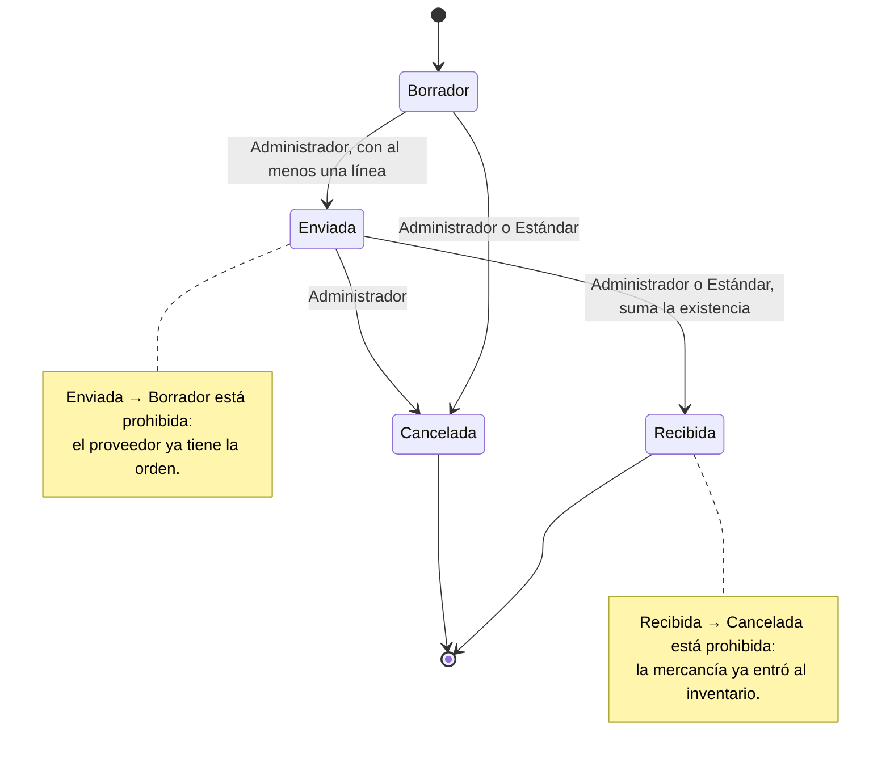

# Máquina de estados: orden de compra

La entidad central del módulo de negocio es la **orden de compra** (`OrdenDeCompra`): un pedido de mercancía a un proveedor, con una o más líneas (producto, cantidad y costo). Su atributo de estado es la columna `estado` de `inventario.ordenes_de_compra`.

| Qué | Dónde está en el código |
|---|---|
| Estados (RF-NEG-03) | [`EstadoOrdenCompra.cs`](../backend/src/Inventario.Negocio/Ordenes/EstadoOrdenCompra.cs) |
| Transiciones permitidas, prohibidas explícitas y terminales (RD-04, RF-NEG-04, RF-NEG-05) | [`TransicionesOrdenCompra.cs`](../backend/src/Inventario.Negocio/Ordenes/TransicionesOrdenCompra.cs): `Permitidas`, `Prohibidas` y `Terminales` |
| Aplicación de una transición | `TransicionesOrdenCompra.Resolver`. `OrdenDeCompra.CambiarEstado` solo la llama. |
| Pruebas | [`TransicionesOrdenCompraPruebas.cs`](../backend/tests/Inventario.Negocio.Pruebas/TransicionesOrdenCompraPruebas.cs) |

`Resolver` busca la transición en `Permitidas`. Si no está, la rechaza (409) con el motivo de `Prohibidas` o el de un estado terminal. Si el rol no está en «Quién», la rechaza (403). Si no se cumple la condición, la rechaza (409). Solo si pasa todo aplica el efecto y cambia el estado. En los tres rechazos la orden queda exactamente como estaba. Agregar una transición nueva es agregar una línea en `Permitidas`; ningún otro archivo valida estados.

## Estados

| Estado | Significado | ¿Terminal? |
|---|---|---|
| Borrador | La orden se está armando: se le pueden agregar líneas. Toda orden nace aquí. | No |
| Enviada | Se le envió al proveedor y se espera la mercancía. | No |
| Recibida | La mercancía llegó y entró al inventario. | **Sí** |
| Cancelada | Se anuló antes de recibirla. | **Sí** |

Solo una orden en Borrador admite líneas nuevas (`TransicionesOrdenCompra.AdmiteCambiosEnLineas`).

## Transiciones permitidas

| # | Desde | Hacia | Quién la ejecuta | Condición | Efecto |
|---|---|---|---|---|---|
| 1 | Borrador | Enviada | Administrador | La orden tiene al menos una línea. | — |
| 2 | Borrador | Cancelada | Administrador o Estándar | Ninguna. | — |
| 3 | Enviada | Recibida | Administrador o Estándar | Ninguna. | La cantidad de cada línea se suma a la existencia de su producto, y queda un movimiento de entrada por línea, con quién y cuándo. |
| 4 | Enviada | Cancelada | Administrador | Ninguna. | — |

## Transiciones prohibidas

Cualquier combinación que no esté en la tabla de permitidas se rechaza (409) y la orden no cambia. Las tres primeras filas están declaradas de forma explícita en `TransicionesOrdenCompra.Prohibidas`, con el motivo que ve el usuario.

| # | Desde | Hacia | Por qué |
|---|---|---|---|
| 1 | Enviada | Borrador | Una orden enviada no vuelve a Borrador: el proveedor ya la tiene. Si hay que cambiarla, se cancela y se hace otra. |
| 2 | Recibida | Cancelada | La mercancía ya entró al inventario; se corrige con un ajuste de existencia. |
| 3 | Borrador | Recibida | No se recibe una orden que no se envió. |
| 4 | Borrador → Borrador, Enviada → Enviada | — | No es un cambio de estado. |
| 5 | Recibida | Borrador, Enviada o Recibida | Recibida es terminal. |
| 6 | Cancelada | Cualquiera | Cancelada es terminal. |

**Estados terminales:** Recibida y Cancelada. `Terminales` se calcula como los estados de los que no parte ninguna transición de `Permitidas`, así que de ellos no se sale.

## Qué prueba cubre cada fila

Las pruebas están en [`TransicionesOrdenCompraPruebas.cs`](../backend/tests/Inventario.Negocio.Pruebas/TransicionesOrdenCompraPruebas.cs). Trabajan sobre la orden en memoria, sin base de datos ni API. En cada prohibida se comprueba el rechazo y que la orden no cambió: estado, fecha de actualización, versión, existencia de los productos y movimientos.

| Fila | Pruebas |
|---|---|
| Permitida 1 | `UnAdministradorEnviaUnaOrdenConLineasYQuedaEnviada`, `EnviarUnaOrdenSinLineasSeRechazaYSigueEnBorrador` (su condición), `UnEstandarNoPuedeEnviarUnaOrdenYSigueEnBorrador` (quién) |
| Permitida 2 | `CancelarUnaOrdenEnBorradorLaDejaCancelada` (Administrador y Estándar) |
| Permitida 3 | `RecibirUnaOrdenEnviadaLaDejaRecibida` (Administrador y Estándar), `RecibirUnaOrdenSumaLaCantidadDeCadaLineaALaExistenciaDelProducto` y `RecibirUnaOrdenDejaUnMovimientoDeEntradaConQuienYCuando` (su efecto) |
| Permitida 4 | `UnAdministradorCancelaUnaOrdenEnviadaYQuedaCancelada`, `UnEstandarNoPuedeCancelarUnaOrdenEnviadaYSigueEnviada` (quién) |
| Prohibida 1 | `PasarUnaOrdenEnviadaABorradorSeRechazaYSigueEnviada` |
| Prohibida 2 | `CancelarUnaOrdenRecibidaSeRechazaYNoTocaLaExistencia` |
| Prohibida 3 | `RecibirUnaOrdenEnBorradorSinEnviarlaSeRechazaYNoSumaExistencia` |
| Prohibida 4 | `PasarUnaOrdenAlEstadoEnQueYaEstaSeRechazaYNoCambia` (Borrador y Enviada) |
| Prohibidas 5 y 6 (estados terminales) | `DeUnEstadoTerminalNoSeSaleYLaOrdenNoCambia`: desde Recibida y desde Cancelada hacia los cuatro estados, con los dos roles (16 casos) |
| Todas las prohibidas | `UnaTransicionProhibidaSeRechazaYLaOrdenNoCambia`: las 12 combinaciones fuera de la tabla, escritas a mano, con los dos roles (24 casos) |
| Las tablas completas | `LaTablaDeclaraSoloLasCuatroTransicionesPermitidasConQuienLasEjecuta`, `LasProhibidasExplicitasSonLasTresDelDocumento`, `NingunaProhibidaExplicitaEstaEntreLasPermitidas`, `LosEstadosTerminalesSonRecibidaYCancelada`, `LaOrdenTieneLosCuatroEstadosDelDocumento`, `UnaOrdenNuevaNaceEnBorrador` |

## Independencia de la máquina de Gestión de permisos

Esta máquina de estados es del módulo de negocio y no comparte código con la de Gestión de permisos del Core (RF-NEG-09). Cambiar una no obliga a cambiar la otra. Cuando el negocio necesita saber si un usuario tiene un permiso aprobado, le pregunta a Gestión de permisos con `IPermisosConcedidos.EstaConcedidoAsync`, que solo responde sí o no: el negocio no conoce los estados de una solicitud.
